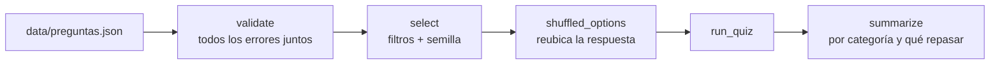

# 01 · Quiz de ciberseguridad

> Herramienta de laboratorio y aprendizaje. No se conecta a nada ni guarda datos personales.

Quiz en la terminal con 24 preguntas de **Redes, Autenticación, Phishing, Malware, SOC y registros y Criptografía**, en tres dificultades. Cada respuesta se explica, las opciones se mezclan para que no se memorice la letra y al final muestra el porcentaje por categoría y qué repasar. Las preguntas viven en un JSON editable que se valida antes de usarse.

[← Volver al portafolio de ciberseguridad](../README.md) · Proyecto relacionado: [05 · Glosario interactivo](../05-glosario/README.md)

## Contenido

1. [Qué problema resuelve](#1-qué-problema-resuelve)
2. [Instalación desde cero](#2-instalación-desde-cero)
3. [Comandos](#3-comandos)
4. [Ejemplo de entrada y salida](#4-ejemplo-de-entrada-y-salida)
5. [Archivos y carpetas](#5-archivos-y-carpetas)
6. [Funciones principales y recorrido de los datos](#6-funciones-principales-y-recorrido-de-los-datos)
7. [Dependencias](#7-dependencias)
8. [Limitaciones y errores frecuentes](#8-limitaciones-y-errores-frecuentes)
9. [Pruebas](#9-pruebas)
10. [Ejercicios](#10-ejercicios)
11. [Preguntas de entrevista](#11-preguntas-de-entrevista)
12. [Guion de demostración](#12-guion-de-demostración)
13. [Capturas](#13-capturas)

## 1. Qué problema resuelve

Estudiar para Security+ o para una entrevista de SOC requiere repasar conceptos con preguntas, no solo leer. Este quiz sirve para practicar y, como proyecto de programación, enseña a separar **datos** (un JSON que cualquiera puede editar) de **lógica**, a validar entradas antes de usarlas y a hacer que algo aleatorio sea reproducible con una semilla.

Las preguntas conectan con el resto del laboratorio: password spraying (proyecto 12), doble extensión y tipo real de archivo (13), DMARC y enlaces engañosos (06), hashes (07).

## 2. Instalación desde cero

Requisitos: Python 3.10 o superior.

**Linux Mint**

```bash
cd Tipos-de-Proyectos/ciberseguridad/01-quiz-ciberseguridad
python3 -m venv .venv
source .venv/bin/activate
python -m pip install -r requirements-dev.txt
```

**Windows (PowerShell)**

```powershell
cd Tipos-de-Proyectos\ciberseguridad\01-quiz-ciberseguridad
py -m venv .venv
.\.venv\Scripts\Activate.ps1
python -m pip install -r requirements-dev.txt
```

## 3. Comandos

Ejecuta todo desde la carpeta `ciberseguridad/01-quiz-ciberseguridad`.

| Objetivo | Comando |
|---|---|
| Quiz de 5 preguntas al azar | `python -m security_quiz` |
| Solo una categoría | `python -m security_quiz --category "SOC y registros"` |
| Solo difíciles, todas | `python -m security_quiz --difficulty dificil --count 0` |
| Repetir exactamente la misma selección | `python -m security_quiz --seed 7` |
| Demostración sin teclear | `python -m security_quiz --category "SOC y registros" --count 3 --seed 7 --answers A,A,D` |
| Ver categorías | `python -m security_quiz --list` |
| Validar el banco después de editarlo | `python -m security_quiz --validate` |
| Pruebas | `python -m pytest` |

En modo interactivo responde con A, B, C o D (sin importar mayúsculas) o S para saltar. `--no-shuffle` mantiene el orden original de las opciones y `--bank` usa otro archivo de preguntas.

Códigos de salida: `0` correcto, `1` error del banco o filtros sin resultados, `2` argumentos inválidos.

## 4. Ejemplo de entrada y salida

```bash
python -m security_quiz --category "SOC y registros" --count 3 --seed 7 --answers A,A,D
```

Salida real (fragmento):

```text
Quiz de ciberseguridad - Cybersecurity Python Lab
=================================================

Pregunta 1/3  [SOC y registros · media]
Una alerta resultó ser actividad legítima (un respaldo nocturno). ¿Cómo se llama?
  A) Falso positivo
  B) Verdadero positivo
  C) Indicador de compromiso
  D) Falso negativo
Tu respuesta: A
Correcto.
Por qué: Falso positivo: la regla alertó pero no había ataque. Un falso negativo es lo contrario (hubo ataque y no hubo alerta), y suele ser más grave.
...
Resultado
=========
Aciertos: 3 de 3 (100 %) | saltadas: 0
  SOC y registros    3/3
¡Bien! Ninguna categoría por debajo del 70 %.
```

Formato de cada pregunta en `data/preguntas.json`:

```json
{
  "id": "soc-03", "categoria": "SOC y registros", "dificultad": "media",
  "pregunta": "Una alerta resultó ser actividad legítima (un respaldo nocturno). ¿Cómo se llama?",
  "opciones": ["Falso negativo", "Falso positivo", "Verdadero positivo", "Indicador de compromiso"],
  "respuesta": "B",
  "explicacion": "Falso positivo: la regla alertó pero no había ataque..."
}
```

## 5. Archivos y carpetas

```
01-quiz-ciberseguridad/
├── README.md
├── requirements.txt / requirements-dev.txt / pytest.ini
├── data/preguntas.json      24 preguntas editables
├── security_quiz/
│   ├── __main__.py
│   ├── bank.py              lectura, validación, selección y mezcla de opciones
│   └── cli.py               modo interactivo, --answers, --list, --validate, resumen
├── tests/
└── docs/screenshots/
```

## 6. Funciones principales y recorrido de los datos



1. **`validate`** revisa cada pregunta (id único, 4 opciones distintas, respuesta A-D, dificultad válida, explicación) y junta todos los errores con el id de la pregunta.
2. **`select`** filtra sin importar acentos ni mayúsculas (`normalize`) y elige con `random.Random(semilla)`: la misma semilla da la misma selección.
3. **`shuffled_options`** mezcla las opciones y devuelve el nuevo índice de la correcta.
4. **`run_quiz`** recibe la función `ask` (por defecto `input`), así las pruebas simulan al usuario sin teclado.

## 7. Dependencias

| Paquete | Para qué | Cuándo |
|---|---|---|
| Biblioteca estándar (`json`, `random`, `unicodedata`, `argparse`) | todo | siempre |
| `pytest` | pruebas | solo desarrollo |

## 8. Limitaciones y errores frecuentes

**Limitaciones**

- No guarda historial de resultados entre sesiones (ejercicio 2).
- El banco es pequeño (24 preguntas); está pensado para que lo amplíes.
- `random` sirve para un quiz; para secretos se usa `secrets` (como en el proyecto 02).

**Errores frecuentes**

| Mensaje | Causa | Solución |
|---|---|---|
| `el banco tiene errores: pregunta 'x': ...` | edición del JSON con un campo faltante o inválido | corrige lo que indica cada línea |
| `no es JSON válido (línea N, columna M)` | coma de más o comillas sin cerrar | revisa esa posición |
| `no hay categoría ...` | nombre distinto | usa `--list` |

## 9. Pruebas

```bash
python -m pytest
python -m pytest -v
```

| Archivo | Qué comprueba |
|---|---|
| `test_quiz.py` | banco válido con 6 categorías, respuestas repartidas entre letras, 6 tipos de error de validación, todos los errores juntos, dificultad con acento, selección reproducible y sin importar mayúsculas, la respuesta correcta sobrevive a la mezcla (20 semillas), 100 % con las respuestas correctas, saltar y "Repasa", reintento ante entrada inválida, fin de entrada, `--list`, `--validate`, errores, ejecución con `python -m` |

**Pruebas ejecutadas** al preparar esta entrega (Linux x86_64 en la nube, 24 de noviembre de 2026): `python -m pytest` → **20 passed** con Python 3.11 y 3.13.

**Pruebas pendientes de ejecutar por ti**: Linux Mint y Windows en tus equipos.

## 10. Ejercicios

1. **Más preguntas.** Agrega 6 preguntas de una categoría nueva ("Linux" o "Windows") y ejecuta `--validate`. Comprueba que `--list` la muestre.
2. **Historial.** Guarda cada resultado en `output/historial.csv` (fecha, categoría, aciertos, total) y agrega `--stats` para ver tu avance.
3. **Modo examen.** Agrega `--time-limit 60` que marque como saltada una pregunta si tardas más de 60 segundos (mide con `time.monotonic`).

## 11. Preguntas de entrevista

**1. ¿Por qué las preguntas están en un JSON y no en el código?**
Para separar datos de lógica: cualquier persona puede agregar preguntas sin tocar Python, y el código no cambia. Como el JSON lo edita una persona, lo valido completo antes de usarlo.

**2. ¿Por qué reportas todos los errores del banco y no solo el primero?**
Porque quien edita corrige todo de una vez. Si solo muestro el primero, tiene que ejecutar y corregir diez veces.

**3. ¿Para qué sirve la semilla?**
Para que algo aleatorio sea reproducible: con `--seed 7` siempre salen las mismas preguntas en el mismo orden. Sirve para demostraciones, para comparar resultados y para pruebas automáticas.

**4. ¿Por qué mezclas las opciones?**
Para que el quiz mida conocimiento y no memoria de la letra. Al mezclar hay que recalcular dónde quedó la respuesta correcta; una prueba lo verifica con 20 semillas.

**5. ¿Cómo pruebas un programa interactivo?**
Inyecto la función que lee la respuesta: en producción es `input`, en las pruebas es una función que devuelve respuestas predefinidas. También pruebo el fin de entrada (`EOFError`), que en un script cuenta como "saltar".

## 12. Guion de demostración

Duración aproximada: 1 minuto y medio.

1. (15 s) "Este es el quiz de mi laboratorio; lo uso para repasar para Security+ y entrevistas SOC."
2. (20 s) Ejecuta `python -m security_quiz --list`.
3. (35 s) Ejecuta `python -m security_quiz --category "SOC y registros" --count 3` y responde en vivo; lee una explicación.
4. (20 s) Abre `data/preguntas.json`, rompe una pregunta (borra la explicación) y ejecuta `--validate` para mostrar el error claro. Deshaz el cambio.

## 13. Capturas

Pendiente: agrega capturas reales después de ejecutar la herramienta en tu equipo y guárdalas en [`docs/screenshots/`](docs/screenshots/README.md).
