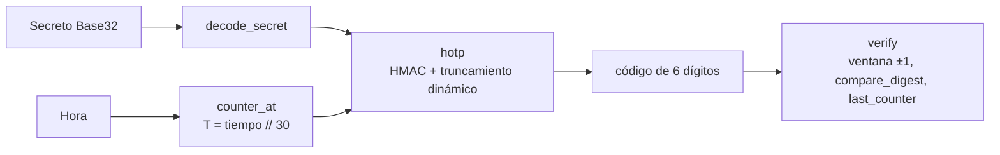

# 02 · Laboratorio de códigos 2FA (TOTP)

> Herramienta de laboratorio y aprendizaje. Usa el secreto de demostración público del RFC; **no la uses para proteger cuentas reales**.

Genera, verifica y **explica paso a paso** los códigos de 6 dígitos de las apps de autenticación (TOTP, RFC 6238). Implementa HMAC y el truncamiento dinámico con la biblioteca estándar y comprueba el resultado con los 18 vectores oficiales del RFC 6238 y los 10 del RFC 4226. Incluye ventana de tolerancia para relojes desfasados y rechazo de códigos repetidos.

[← Volver al portafolio de ciberseguridad](../README.md) · Proyecto relacionado: [09 · Contador de intentos de login](../09-contador-logins/README.md)

## Contenido

1. [Qué problema resuelve](#1-qué-problema-resuelve)
2. [Instalación desde cero](#2-instalación-desde-cero)
3. [Comandos](#3-comandos)
4. [Ejemplo de entrada y salida](#4-ejemplo-de-entrada-y-salida)
5. [Archivos y carpetas](#5-archivos-y-carpetas)
6. [Funciones principales y recorrido de los datos](#6-funciones-principales-y-recorrido-de-los-datos)
7. [Dependencias](#7-dependencias)
8. [Limitaciones y errores frecuentes](#8-limitaciones-y-errores-frecuentes)
9. [Pruebas](#9-pruebas)
10. [Ejercicios](#10-ejercicios)
11. [Preguntas de entrevista](#11-preguntas-de-entrevista)
12. [Guion de demostración](#12-guion-de-demostración)
13. [Capturas](#13-capturas)

## 1. Qué problema resuelve

La autenticación de dos factores (2FA) detiene la mayoría de los accesos con contraseñas robadas, pero pocas personas saben **cómo** sabe el servidor que el código del teléfono es correcto sin que viaje nada por la red. Este laboratorio lo muestra con números: el servidor y el teléfono comparten un secreto y calculan el mismo código a partir de la hora.

Útil para:

- Entender TOTP para explicarlo en una entrevista o a un usuario de soporte ("¿por qué mi código no funciona?": casi siempre es el reloj).
- Ver por qué un servidor acepta el código anterior (ventana) y por qué no debe aceptar el mismo código dos veces (repetición).
- Validar otra implementación contra los vectores oficiales.

## 2. Instalación desde cero

Requisitos: Python 3.10 o superior.

**Linux Mint**

```bash
cd Tipos-de-Proyectos/ciberseguridad/02-laboratorio-2fa
python3 -m venv .venv
source .venv/bin/activate
python -m pip install -r requirements-dev.txt
```

**Windows (PowerShell)**

```powershell
cd Tipos-de-Proyectos\ciberseguridad\02-laboratorio-2fa
py -m venv .venv
.\.venv\Scripts\Activate.ps1
python -m pip install -r requirements-dev.txt
```

## 3. Comandos

Ejecuta todo desde la carpeta `ciberseguridad/02-laboratorio-2fa`. `samples/secreto_demo.txt` contiene el secreto **público** de los vectores del RFC.

| Objetivo | Comando |
|---|---|
| Comprobar la implementación con el RFC 6238 | `python -m totp_lab rfc-test` |
| Código actual | `python -m totp_lab code --secret-file samples/secreto_demo.txt` |
| Código en una hora fija (reproducible) | `python -m totp_lab code --secret-file samples/secreto_demo.txt --at 2026-11-24T10:00:00-06:00` |
| Explicar el cálculo paso a paso | `python -m totp_lab explain --secret-file samples/secreto_demo.txt --at 2026-11-24T10:00:00-06:00` |
| Verificar un código | `python -m totp_lab verify 120159 --secret-file samples/secreto_demo.txt --at 2026-11-24T10:00:25-06:00` |
| Rechazar un código ya usado | agrega `--last-counter 59851200` al comando anterior |
| Sin tolerancia de reloj | agrega `--window 0` |
| Generar un secreto nuevo | `python -m totp_lab secret` o `python -m totp_lab secret --save secrets/mio.secret` |
| URI `otpauth://` para una app | `python -m totp_lab uri --secret-file samples/secreto_demo.txt --account ana@empresa.example --issuer "Laboratorio 2FA"` |
| Pruebas | `python -m pytest` |

El secreto se lee de `--secret-file`, de la variable de entorno `TOTP_SECRET` o de `--secret` (en ese orden). `--secret` muestra un aviso porque queda guardado en el historial de la terminal.

Opciones comunes: `--digits 6|7|8`, `--period SEGUNDOS` (30), `--algorithm SHA1|SHA256|SHA512` (SHA1, el de casi todas las apps). `--at` acepta ISO 8601 (sin zona = UTC) o segundos Unix.

Códigos de salida: `0` correcto (o código válido), `1` error de entrada, `2` argumentos inválidos, `3` código rechazado o vector RFC fallido.

## 4. Ejemplo de entrada y salida

```bash
python -m totp_lab explain --secret-file samples/secreto_demo.txt --at 2026-11-24T10:00:00-06:00
```

Salida real:

```text
1. Hora: 1795536000 s desde 1970 (2026-11-24T16:00:00+00:00)
2. Contador T = (1795536000 - 0) // 30 = 59851200
3. T en 8 bytes big-endian: 00000000039141c0
4. HMAC-SHA1(secreto, T) = e6a93d26c0d4e72387951109e6cadfcb8ad15c6b
5. Último medio byte = 11 -> se toman 4 bytes desde la posición 11: 09e6cadf
6. Sin el bit de signo: 166120159
7. 166120159 mod 10^6 = 120159  <- código
```

Verificación 25 segundos después y repetición:

```text
$ python -m totp_lab verify 120159 --secret-file samples/secreto_demo.txt --at 2026-11-24T10:00:25-06:00
VÁLIDO: código válido (del periodo actual; contador T = 59851200).
Guarda el contador 59851200 y pásalo como --last-counter para rechazar que se repita.

$ python -m totp_lab verify 120159 --secret-file samples/secreto_demo.txt --at 2026-11-24T10:00:25-06:00 --last-counter 59851200
RECHAZADO: código ya usado (o anterior al último aceptado): posible repetición.
```

Vectores oficiales (`python -m totp_lab rfc-test`, final de la salida):

```text
 20000000000  SHA1       65353130  65353130  OK
 20000000000  SHA256     77737706  77737706  OK
 20000000000  SHA512     47863826  47863826  OK

18 de 18 vectores coinciden.
```

## 5. Archivos y carpetas

```
02-laboratorio-2fa/
├── README.md
├── requirements.txt / requirements-dev.txt / pytest.ini
├── totp_lab/
│   ├── __main__.py
│   ├── cli.py          subcomandos, lectura segura del secreto, fechas, códigos de salida
│   └── totp.py         hotp, totp, verify, explain, provisioning_uri y vectores del RFC
├── samples/
│   └── secreto_demo.txt  secreto PÚBLICO de los vectores del RFC 6238
├── tests/
└── docs/screenshots/
```

## 6. Funciones principales y recorrido de los datos



1. **`decode_secret`** acepta el secreto como lo muestran las apps (minúsculas, espacios, sin `=`), valida Base32 y exige al menos 80 bits.
2. **`hotp`** (RFC 4226): HMAC del contador en 8 bytes big-endian; los 4 bits finales del HMAC eligen 4 bytes; se quita el bit de signo y se toma módulo 10⁶.
3. **`totp`** (RFC 6238) es `hotp` con el contador `T = (tiempo - T0) // periodo`.
4. **`verify`** compara con `hmac.compare_digest` (tiempo constante) en los periodos `-ventana..+ventana`, recorriéndolos todos aunque haya coincidencia temprana, y rechaza contadores menores o iguales a `last_counter`.
5. **`generate_secret`** usa `secrets.token_bytes` (generador criptográfico), nunca `random`.

## 7. Dependencias

| Paquete | Para qué | Cuándo |
|---|---|---|
| Biblioteca estándar (`hmac`, `hashlib`, `base64`, `secrets`, `struct`, `urllib.parse`) | todo | siempre |
| `pytest` | pruebas | solo desarrollo |

**Decisión de esta entrega.** El plan original (ver [docs/ARQUITECTURA.md](../docs/ARQUITECTURA.md)) preveía usar una biblioteca TOTP mantenida. Se decidió implementarlo con la biblioteca estándar porque el objetivo del proyecto es **entender** el algoritmo, y la corrección se demuestra con los vectores oficiales del RFC. En una aplicación real usaría una biblioteca mantenida (por ejemplo, `pyotp`) y estas mismas pruebas para verificarla.

## 8. Limitaciones y errores frecuentes

**Limitaciones**

- No guarda el último contador por cuenta: `--last-counter` lo recibe a mano. Un servidor real lo guarda en su base de datos.
- No limita intentos: con 6 dígitos hay un millón de combinaciones y un atacante con muchos intentos podría adivinar. Un servidor real bloquea tras pocos fallos (ver proyecto 12).
- No genera el código QR (se puede crear con cualquier generador a partir de la URI `otpauth://`, sin publicarla).
- TOTP no protege contra phishing en tiempo real: si el usuario escribe el código en un sitio falso, el atacante lo usa de inmediato. Las llaves FIDO2/passkeys sí lo evitan.

**Errores frecuentes**

| Síntoma | Causa | Solución |
|---|---|---|
| `RECHAZADO` con un código que la app muestra bien | reloj del equipo o del teléfono desfasado | sincroniza la hora; `--window 2` lo tolera |
| `el secreto no es Base32 válido` | caracteres fuera de A-Z y 2-7 (por ejemplo `0`, `1`, `8`) | copia el secreto exacto de la app |
| `falta el secreto` | no se indicó ninguna fuente | usa `--secret-file` |
| Un secreto en `--secret` aparece en el historial | así funciona la terminal | usa `--secret-file` o `TOTP_SECRET` |

## 9. Pruebas

```bash
python -m pytest
python -m pytest -v
```

| Archivo | Qué comprueba |
|---|---|
| `test_totp.py` | 10 vectores HOTP del RFC 4226, 18 vectores TOTP del RFC 6238 (SHA1, SHA256, SHA512), secretos aleatorios de 160 bits, Base32 con espacios y minúsculas, secretos inválidos o cortos, ventana, repetición, formato del código, validación de la configuración, `explain` y la URI |
| `test_cli.py` | código y verificación en hora fija, repetición, secreto desde variable de entorno, aviso con `--secret`, errores, `explain`, `rfc-test`, guardar secreto con permisos 600 y sin sobrescribir, URI, fechas ISO y Unix, ejecución con `python -m` |

**Pruebas ejecutadas** al preparar esta entrega (Linux x86_64 en la nube, 24 de noviembre de 2026): `python -m pytest` → **62 passed** con Python 3.11 y 3.13.

**Pruebas pendientes de ejecutar por ti**: Linux Mint y Windows en tus equipos.

## 10. Ejercicios

1. **Contrastar con tu teléfono.** Genera un secreto con `python -m totp_lab secret`, conviértelo a URI, regístralo en una app de autenticación escribiendo el secreto a mano y compara códigos. Luego borra la cuenta de la app.
2. **Registro de contadores.** Agrega `--state archivo.json` que guarde el último contador aceptado por cuenta y lo aplique automáticamente.
3. **Límite de intentos.** Agrega un contador de fallos por cuenta que bloquee 5 minutos tras 5 fallos, y una prueba que simule 6 intentos.

## 11. Preguntas de entrevista

**1. ¿Cómo sabe el servidor que mi código es correcto si no lo envía el teléfono antes?**
Porque ambos tienen el mismo secreto (se compartió al escanear el QR) y la misma hora. Cada uno calcula HMAC del contador de 30 segundos y el resultado es el mismo. Solo viaja el código que escribes.

**2. ¿Por qué el servidor acepta también el código anterior?**
Porque los relojes no están perfectamente sincronizados y el usuario tarda en escribir. Acepto ±1 periodo (±30 s). Una ventana más grande facilita adivinar, así que es un equilibrio entre usabilidad y seguridad.

**3. ¿Qué es el ataque de repetición y cómo lo evitas?**
Si alguien ve o intercepta un código, podría usarlo dentro de su ventana de validez. Guardo el contador del último código aceptado y rechazo cualquier código con contador igual o menor.

**4. ¿Por qué `hmac.compare_digest` y no `==`?**
`==` puede terminar en cuanto encuentra un carácter distinto, y el tiempo de respuesta revela cuántos dígitos acertaste. `compare_digest` tarda lo mismo siempre. También recorro toda la ventana aunque ya haya coincidido.

**5. ¿TOTP protege contra phishing?**
No del todo. Si una página falsa pide usuario, contraseña y código, el atacante puede usarlos al instante. Protege contra contraseñas filtradas reutilizadas, pero para phishing las llaves FIDO2 o passkeys son mejores, porque están ligadas al dominio real.

## 12. Guion de demostración

Duración aproximada: 2 minutos.

1. (15 s) "Este es mi laboratorio de 2FA: implementé TOTP para entender qué hace la app del teléfono."
2. (20 s) Ejecuta `python -m totp_lab rfc-test`: "18 de 18 vectores oficiales del RFC coinciden".
3. (35 s) Ejecuta `explain` con `--at 2026-11-24T10:00:00-06:00` y recorre los 7 pasos.
4. (20 s) Verifica `120159` 25 segundos después: válido.
5. (15 s) Repite con `--last-counter 59851200`: rechazado por repetición.
6. (15 s) Cierra: "TOTP protege contra contraseñas filtradas; contra phishing en tiempo real, mejor FIDO2".

## 13. Capturas

Pendiente: agrega capturas reales después de ejecutar la herramienta en tu equipo y guárdalas en [`docs/screenshots/`](docs/screenshots/README.md).
