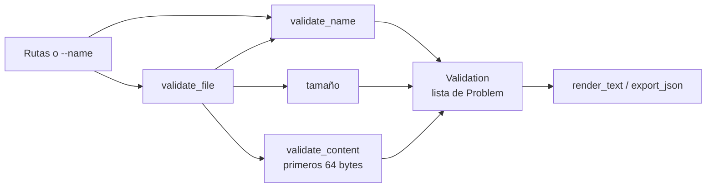

# 03 · Validador de archivos

> Herramienta de laboratorio y aprendizaje. Solo lee archivos locales; no borra, mueve ni renombra nada.

Revisa archivos como lo haría el filtro de un formulario de subida: extensión en una **lista blanca**, tamaño, nombre seguro (rutas con `..`, nombres reservados de Windows, caracteres invisibles, doble extensión) y que el contenido coincida con la extensión. Cada rechazo dice el motivo y **por qué importa**, y propone un nombre seguro cuando el problema es el nombre.

[← Volver al portafolio de ciberseguridad](../README.md) · Proyectos relacionados: [13 · Verificador de archivos sospechosos](../13-verificador-archivos/README.md), [10 · Clasificador de archivos](../10-clasificador-archivos/README.md)

## Contenido

1. [Qué problema resuelve](#1-qué-problema-resuelve)
2. [Instalación desde cero](#2-instalación-desde-cero)
3. [Comandos](#3-comandos)
4. [Ejemplo de entrada y salida](#4-ejemplo-de-entrada-y-salida)
5. [Archivos y carpetas](#5-archivos-y-carpetas)
6. [Funciones principales y recorrido de los datos](#6-funciones-principales-y-recorrido-de-los-datos)
7. [Dependencias](#7-dependencias)
8. [Limitaciones y errores frecuentes](#8-limitaciones-y-errores-frecuentes)
9. [Pruebas](#9-pruebas)
10. [Ejercicios](#10-ejercicios)
11. [Preguntas de entrevista](#11-preguntas-de-entrevista)
12. [Guion de demostración](#12-guion-de-demostración)
13. [Capturas](#13-capturas)

## 1. Qué problema resuelve

Las subidas de archivos son una de las entradas más peligrosas de una aplicación web: un nombre como `../../config.php` puede escribir fuera de la carpeta destino, `factura.pdf.exe` engaña a quien lo descarga y un ejecutable renombrado a `.pdf` pasa cualquier filtro que solo mire la extensión. Esta herramienta reúne esas validaciones y explica cada decisión.

Útil para:

- Aprender validación de entrada con **lista blanca** (aceptar solo lo necesario).
- Probar las reglas antes de programarlas en una aplicación real.
- Explicar a un usuario por qué su archivo fue rechazado.

## 2. Instalación desde cero

Requisitos: Python 3.10 o superior.

**Linux Mint**

```bash
cd Tipos-de-Proyectos/ciberseguridad/03-validador-archivos
python3 -m venv .venv
source .venv/bin/activate
python -m pip install -r requirements-dev.txt
```

**Windows (PowerShell)**

```powershell
cd Tipos-de-Proyectos\ciberseguridad\03-validador-archivos
py -m venv .venv
.\.venv\Scripts\Activate.ps1
python -m pip install -r requirements-dev.txt
```

## 3. Comandos

Ejecuta todo desde la carpeta `ciberseguridad/03-validador-archivos`.

| Objetivo | Comando |
|---|---|
| Validar la carpeta de ejemplo | `python -m file_validator samples/subidas` |
| Validar nombres que no puedes crear en tu sistema | `python -m file_validator --name CON.txt --name "../../config.txt" --name factura.pdf.exe` |
| Usar reglas más estrictas | `python -m file_validator samples/subidas --config samples/reglas_estrictas.json` |
| Solo nombre y tamaño | `python -m file_validator samples/subidas --no-content` |
| Exportar | `python -m file_validator samples/subidas --export-json output/validacion.json` |
| Ayuda | `python -m file_validator --help` |
| Pruebas | `python -m pytest` |

Reglas en `config/settings.json`:

| Clave | Uso | Valor por defecto |
|---|---|---|
| `allowed_extensions` | lista blanca de extensiones | `.pdf .png .jpg .jpeg .txt .csv .docx` |
| `max_size_bytes` | tamaño máximo | `5242880` (5 MiB) |
| `max_name_length` | caracteres máximos del nombre | `100` |
| `allow_hidden` | acepta nombres que empiezan con punto | `false` |
| `check_content` | compara los primeros bytes con la extensión | `true` |

Códigos de salida: `0` todo aceptado, `3` algún rechazo, `1` error de entrada, configuración o exportación, `2` argumentos inválidos. Así se puede usar en un script: `python -m file_validator archivo.pdf && echo "se puede subir"`.

## 4. Ejemplo de entrada y salida

`samples/subidas/` simula 10 archivos que subieron usuarios (ver [samples/README.md](samples/README.md)).

```bash
python -m file_validator samples/subidas --name factura.pdf.exe --name CON.txt --name ../../config.txt
```

Salida real (fragmento):

```text
Validador de archivos - Cybersecurity Python Lab
================================================

Revisados: 13 | aceptados: 5 | rechazados: 8
Reglas: extensiones .csv, .docx, .jpeg, .jpg, .pdf, .png, .txt | máximo 5242880 bytes | nombre de hasta 100 caracteres | revisar contenido: sí

[RECHAZADO] '.htaccess' (42 bytes)
  - NOMBRE_OCULTO: empieza con punto (archivo oculto en Linux y macOS)
      Por qué importa: un archivo oculto pasa desapercibido; también podría sobrescribir configuraciones como .htaccess
  - EXTENSION_NO_PERMITIDA: la extensión '.htaccess' no está permitida (permitidas: .csv, .docx, .jpeg, .jpg, .pdf, .png, .txt)
      Por qué importa: lista blanca: solo se acepta lo que el sistema necesita, no se intenta adivinar lo peligroso

[ACEPTADO ] 'clientes.csv' (63 bytes)
[RECHAZADO] 'comprobante.pdf' (54 bytes)
  - CONTENIDO_NO_COINCIDE: el contenido no corresponde a un archivo '.pdf'
      Por qué importa: la extensión se cambia con solo renombrar; el contenido real es lo que abrirá el programa

[RECHAZADO] 'factura.pdf.exe' (solo nombre)
  - DOBLE_EXTENSION: doble extensión que termina en ejecutable: '.pdf.exe'
      Por qué importa: Windows oculta la última extensión: el usuario vería un documento y ejecutaría un programa
  - EXTENSION_NO_PERMITIDA: la extensión '.exe' no está permitida (permitidas: .csv, .docx, .jpeg, .jpg, .pdf, .png, .txt)
      ...

[RECHAZADO] 'CON.txt' (solo nombre)
  - NOMBRE_RESERVADO: 'CON' es un nombre reservado de Windows
      Por qué importa: Windows lo trata como un dispositivo (p. ej. la consola), no como un archivo
  Nombre seguro sugerido: _CON.txt

[RECHAZADO] '../../config.txt' (solo nombre)
  - NOMBRE_CON_RUTA: contiene separadores de carpeta o '..'
      Por qué importa: un nombre como '../../config' podría escribir fuera de la carpeta de subidas (path traversal)
  ...
  Nombre seguro sugerido: config.txt
```

`--name` existe porque algunos nombres peligrosos (`CON.txt`, nombres que terminan en punto) ni siquiera se pueden crear en Windows, pero un atacante sí puede enviarlos en una petición web.

## 5. Archivos y carpetas

```
03-validador-archivos/
├── README.md
├── requirements.txt / requirements-dev.txt / pytest.ini
├── config/settings.json       reglas del filtro
├── file_validator/
│   ├── __main__.py
│   ├── cli.py                 argumentos, --name, códigos de salida
│   ├── config.py              lee y valida las reglas
│   ├── rules.py               validate_name, validate_content, validate_file, safe_storage_name
│   └── report.py              texto y JSON; escapa caracteres de control
├── samples/
│   ├── README.md
│   ├── reglas_estrictas.json  reglas alternativas para practicar
│   └── subidas/               10 archivos sintéticos
├── tests/
└── docs/screenshots/
```

## 6. Funciones principales y recorrido de los datos



1. **`validate_name`** aplica las reglas de nombre: vacío, caracteres de control o invisibles, separadores y `..`, caracteres prohibidos en Windows, nombres reservados (`CON`, `PRN`, `AUX`, `NUL`, `COM1`-`COM9`, `LPT1`-`LPT9`), punto o espacio final, longitud, oculto, doble extensión ejecutable y lista blanca.
2. **`validate_file`** suma tamaño (vacío o mayor al máximo) y contenido.
3. **`validate_content`** compara los primeros bytes con la firma esperada (`%PDF-`, PNG, JPEG, GIF, ZIP para Office moderno); detecta ejecutables (`MZ`, ELF) con cualquier extensión y binarios con extensión de texto.
4. **`safe_storage_name`** propone un nombre seguro: sin rutas, sin acentos, solo letras, números, `-` y `_`, extensión en minúsculas.

## 7. Dependencias

| Paquete | Para qué | Cuándo |
|---|---|---|
| Biblioteca estándar (`pathlib`, `unicodedata`, `re`, `json`, `argparse`) | todo | siempre |
| `pytest` | pruebas | solo desarrollo |

## 8. Limitaciones y errores frecuentes

**Limitaciones**

- Valida, no desinfecta: un PDF real con JavaScript pasa este filtro (el [proyecto 13](../13-verificador-archivos/README.md) lo detecta).
- La firma de `.docx` es la de ZIP: un ZIP cualquiera renombrado a `.docx` pasa la revisión de contenido.
- No revisa subcarpetas.
- En una aplicación real, además, el archivo se guarda con un nombre generado por el servidor (no el del usuario), fuera de la carpeta pública y con permisos sin ejecución.

**Errores frecuentes**

| Mensaje | Causa | Solución |
|---|---|---|
| `'allowed_extensions' debe ser una lista de extensiones que empiecen con punto` | escribiste `"pdf"` en vez de `".pdf"` | agrega el punto |
| `no es JSON válido (línea N)` | coma de más o comillas faltantes | revisa esa línea |
| Código de salida 3 en un script | hay rechazos (no es un error del programa) | revisa el reporte |

## 9. Pruebas

```bash
python -m pytest
python -m pytest -v
```

| Archivo | Qué comprueba |
|---|---|
| `test_rules.py` | 18 nombres inválidos y 4 válidos, nombres reservados solo como palabra completa, doble extensión solo con ejecutable al final, contenido PNG/PDF/ejecutable/binario, vacío y tamaño, resultados exactos de los ejemplos con reglas normales y estrictas, configuración inválida, nombres seguros |
| `test_cli.py` | resumen y códigos de salida 0/1/2/3, `--name`, `--no-content`, `--config`, exportación y `--force`, escape de caracteres de control, ejecución con `python -m` |

**Pruebas ejecutadas** al preparar esta entrega (Linux x86_64 en la nube, 24 de noviembre de 2026): `python -m pytest` → **55 passed** con Python 3.11 y 3.13.

**Pruebas pendientes de ejecutar por ti**: Linux Mint y Windows en tus equipos.

## 10. Ejercicios

1. **Imágenes con dimensiones.** Para PNG, lee el ancho y alto del encabezado `IHDR` (bytes 16 a 24) y rechaza imágenes de más de 4000 px por lado. Escribe una prueba con una imagen de 1×1 y otra con un encabezado falso enorme.
2. **Copiar los aceptados.** Agrega `--copy-accepted CARPETA` que copie (no mueva) los archivos aceptados con su nombre seguro y sin sobrescribir nada.
3. **Lista negra vs. lista blanca.** Cambia temporalmente la lógica a "rechazar solo `.exe`" y busca tres nombres que pasen y sean peligrosos. Anota en `docs/METODOLOGIA.md` por qué volviste a la lista blanca.

## 11. Preguntas de entrevista

**1. ¿Por qué lista blanca y no lista negra?**
Con una lista negra tengo que adivinar todo lo peligroso (`.exe`, `.scr`, `.hta`, `.js`, `.phtml`...) y siempre faltará algo. Con lista blanca acepto solo lo que el sistema necesita y todo lo demás se rechaza por defecto.

**2. Si ya validas la extensión, ¿por qué revisas el contenido?**
Porque renombrar un archivo cuesta un segundo. Un ejecutable llamado `comprobante.pdf` pasa un filtro de extensión. Los primeros bytes (`%PDF-`, `MZ`) dicen qué abrirá realmente el programa.

**3. ¿Qué es path traversal en una subida?**
Si el servidor usa el nombre que envía el usuario para guardar, `../../config.txt` puede escribir fuera de la carpeta de subidas. Lo rechazo, y además en una aplicación real el servidor no debería usar ese nombre: genera uno propio.

**4. ¿Por qué te preocupa `CON.txt` si estás en Linux?**
Porque el archivo puede terminar en un equipo o recurso compartido con Windows, donde `CON` es la consola y no un archivo. Lo mismo con nombres que terminan en punto o espacio: Windows los recorta en silencio.

**5. ¿Qué harías con un archivo aceptado en un sistema real?**
Guardarlo con un nombre generado por el servidor (por ejemplo, un UUID), fuera de la carpeta pública, sin permiso de ejecución, y si es posible pasarlo por un antivirus. Esta herramienta es solo la primera capa.

## 12. Guion de demostración

Duración aproximada: 2 minutos.

1. (15 s) "Este es el validador de subidas de mi laboratorio: decide qué archivo aceptaría un formulario y explica por qué."
2. (25 s) Ejecuta `python -m file_validator samples/subidas` y lee el resumen: 5 aceptados, 5 rechazados.
3. (20 s) Señala `comprobante.pdf`: "dice PDF pero es texto; por eso miro el contenido, no solo la extensión".
4. (25 s) Ejecuta con `--name factura.pdf.exe --name CON.txt --name ../../config.txt` y explica doble extensión, nombre reservado y path traversal.
5. (20 s) Muestra los nombres seguros sugeridos y ejecuta con `--config samples/reglas_estrictas.json`.
6. (15 s) Cierra: "lista blanca, contenido real y nombres que genera el servidor".

## 13. Capturas

Pendiente: agrega capturas reales después de ejecutar la herramienta en tu equipo y guárdalas en [`docs/screenshots/`](docs/screenshots/README.md).
