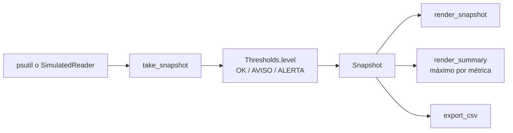

# 04 · Monitor básico del sistema

> Herramienta de laboratorio y aprendizaje. Solo lee mediciones del equipo; no cambia nada ni necesita permisos de administrador.

Mide CPU, memoria y espacio en disco con `psutil`, los compara con umbrales de **AVISO** y **ALERTA** configurables, toma varias muestras con un intervalo, resume el máximo de cada métrica y exporta todo a CSV. Un modo `--demo` usa valores simulados para mostrar avisos y alertas de forma reproducible.

[← Volver al portafolio de ciberseguridad](../README.md) · Proyecto relacionado: [08 · Generador de reportes](../08-generador-reportes/README.md)

## Contenido

1. [Qué problema resuelve](#1-qué-problema-resuelve)
2. [Instalación desde cero](#2-instalación-desde-cero)
3. [Comandos](#3-comandos)
4. [Ejemplo de entrada y salida](#4-ejemplo-de-entrada-y-salida)
5. [Archivos y carpetas](#5-archivos-y-carpetas)
6. [Funciones principales y recorrido de los datos](#6-funciones-principales-y-recorrido-de-los-datos)
7. [Dependencias](#7-dependencias)
8. [Limitaciones y errores frecuentes](#8-limitaciones-y-errores-frecuentes)
9. [Pruebas](#9-pruebas)
10. [Ejercicios](#10-ejercicios)
11. [Preguntas de entrevista](#11-preguntas-de-entrevista)
12. [Guion de demostración](#12-guion-de-demostración)
13. [Capturas](#13-capturas)

## 1. Qué problema resuelve

Un disco lleno detiene servicios y borra registros nuevos; una CPU al 100 % sin explicación puede ser un proceso de minería de criptomonedas o un ataque. La disponibilidad es una de las tres patas de la seguridad (confidencialidad, integridad y **disponibilidad**), y vigilar recursos es la base de cualquier herramienta de monitoreo como Zabbix, Nagios o Grafana.

Útil para:

- Aprender a medir recursos y a definir umbrales con dos niveles (avisar antes de que sea crítico).
- Tomar una línea base de tu equipo durante unos minutos y guardarla en CSV.
- Practicar código que se prueba sin depender de la carga real de la máquina.

## 2. Instalación desde cero

Requisitos: Python 3.10 o superior.

**Linux Mint**

```bash
cd Tipos-de-Proyectos/ciberseguridad/04-monitor-sistema
python3 -m venv .venv
source .venv/bin/activate
python -m pip install -r requirements-dev.txt
```

**Windows (PowerShell)**

```powershell
cd Tipos-de-Proyectos\ciberseguridad\04-monitor-sistema
py -m venv .venv
.\.venv\Scripts\Activate.ps1
python -m pip install -r requirements-dev.txt
```

`psutil` publica paquetes ya compilados para Linux y Windows, así que no hace falta compilador.

## 3. Comandos

Ejecuta todo desde la carpeta `ciberseguridad/04-monitor-sistema`.

| Objetivo | Comando |
|---|---|
| Demostración con valores simulados | `python -m system_monitor --demo` |
| Una medición de tu equipo | `python -m system_monitor` |
| 30 muestras cada 10 segundos (5 minutos) | `python -m system_monitor --samples 30 --interval 10` |
| Guardar en CSV | `python -m system_monitor --samples 30 --interval 10 --export-csv output/linea_base.csv` |
| Usarlo en un script (código 3 si hay ALERTA) | `python -m system_monitor --fail-on alerta` |
| Umbrales propios | `python -m system_monitor --config mis_umbrales.json` |
| Pruebas | `python -m pytest` |

Umbrales en `config/settings.json` (porcentajes): `cpu` 75/90, `memoria` 80/90 y `disco` 80/90 (aviso/alerta). Ctrl+C detiene el muestreo y conserva lo medido (resumen y CSV).

Códigos de salida: `0` correcto, `1` error de configuración, exportación o falta de `psutil`, `2` argumentos inválidos, `3` se alcanzó el nivel de `--fail-on`.

## 4. Ejemplo de entrada y salida

```bash
python -m system_monitor --demo
```

Salida real (fragmento; los valores son **simulados**):

```text
Modo demostración: valores SIMULADOS (no son de este equipo).

Monitor básico del sistema - Cybersecurity Python Lab
=====================================================
Umbrales (aviso / alerta): cpu 75/90 %, memoria 80/90 %, disco 80/90 %

Muestra 1/3  2026-11-24 13:45:52 UTC
MÉTRICA          USO      USADO      TOTAL  ESTADO
CPU           35.0 %          -          -  OK
Memoria       61.0 %    9.8 GiB   16.0 GiB  OK
Disco /       72.0 %  360.0 GiB  500.0 GiB  OK
Disco /datos  93.0 %  465.0 GiB  500.0 GiB  ALERTA
...
Muestra 3/3  2026-11-24 13:45:56 UTC
MÉTRICA          USO      USADO      TOTAL  ESTADO
CPU           97.5 %          -          -  ALERTA
Memoria       91.0 %   14.6 GiB   16.0 GiB  ALERTA
Disco /       72.0 %  360.0 GiB  500.0 GiB  OK
Disco /datos  93.0 %  465.0 GiB  500.0 GiB  ALERTA

Resumen de 3 muestra(s): máximo por métrica
  CPU            97.5 %  ALERTA
  Memoria        91.0 %  ALERTA
  Disco /        72.0 %  OK
  Disco /datos   93.0 %  ALERTA
Eventos fuera de lo normal: 6
  13:45:52 UTC  ALERTA Disco /datos al 93.0 %
  13:45:54 UTC  AVISO  CPU al 82.0 %
  ...
```

Con tu equipo real (`python -m system_monitor`), en Windows verás discos como `C:\` y en Linux Mint `/` y `/home` si están separados.

## 5. Archivos y carpetas

```
04-monitor-sistema/
├── README.md
├── requirements.txt          psutil
├── requirements-dev.txt / pytest.ini
├── config/settings.json      umbrales de aviso y alerta
├── system_monitor/
│   ├── __main__.py
│   ├── cli.py                argumentos, muestreo, resumen, CSV, códigos de salida
│   └── collector.py          Thresholds, take_snapshot, filtro de discos, lector simulado
├── tests/
└── docs/screenshots/
```

## 6. Funciones principales y recorrido de los datos



1. **`take_snapshot`** recibe un *lector* con la interfaz de `psutil`. `cpu_percent(interval=1)` observa la CPU durante 1 segundo (una sola lectura instantánea no significa nada).
2. **`_disks`** ignora sistemas de archivos virtuales (`squashfs` de los snaps, `tmpfs`), lectores de CD y particiones repetidas del mismo dispositivo; si un disco no se puede leer, lo anota y sigue.
3. **`Thresholds.level`** devuelve `OK`, `AVISO` o `ALERTA`; la configuración se valida (`0 < aviso < alerta <= 100`).
4. **`main`** espera `intervalo - 1` segundos entre muestras (el segundo restante ya se usó para medir la CPU) y acepta funciones `sleep` y `reader` inyectadas para las pruebas.

## 7. Dependencias

| Paquete | Para qué | Cuándo |
|---|---|---|
| `psutil` | leer CPU, memoria y discos igual en Linux, Windows y macOS | siempre (excepto `--demo`) |
| Biblioteca estándar (`argparse`, `csv`, `json`, `time`) | interfaz y exportación | siempre |
| `pytest` | pruebas | solo desarrollo |

Con solo la biblioteca estándar habría que leer `/proc/stat` y `/proc/meminfo` en Linux y llamar a la API de Windows con `ctypes`: más código específico de cada sistema y más fácil de equivocar. Por eso este es uno de los dos proyectos del laboratorio con una dependencia externa.

## 8. Limitaciones y errores frecuentes

**Limitaciones**

- Mide el equipo completo, no procesos individuales (ver ejercicio 2).
- Los porcentajes de memoria cuentan la caché como disponible (criterio de `psutil`): un 60 % no significa que el equipo esté lento.
- No envía notificaciones ni corre en segundo plano; para eso existen Zabbix, Prometheus o el Programador de tareas de Windows con `--fail-on`.
- En contenedores o máquinas virtuales los valores pueden reflejar al anfitrión.

**Errores frecuentes**

| Mensaje | Causa | Solución |
|---|---|---|
| `falta psutil` | no se instalaron las dependencias | `python -m pip install -r requirements.txt` |
| `los umbrales deben cumplir 0 < aviso < alerta <= 100` | umbrales invertidos o fuera de rango | corrige `config/settings.json` |
| `Nota: No se pudo leer D:\` | lector de CD o USB sin medio | normal; se ignora |

## 9. Pruebas

```bash
python -m pytest
python -m pytest -v
```

| Archivo | Qué comprueba |
|---|---|
| `test_monitor.py` | niveles en los bordes de cada umbral, umbrales inválidos, medición con lector simulado, discos repetidos/virtuales/ilegibles, formato de tamaños, demo y `--fail-on`, espera entre muestras con `sleep` inyectado, CSV y `--force`, configuración inválida, argumentos inválidos, Ctrl+C conserva lo medido, una lectura real con `psutil` |

**Pruebas ejecutadas** al preparar esta entrega (Linux x86_64 en la nube, 24 de noviembre de 2026): `python -m pytest` → **26 passed** con Python 3.11 y 3.13 (psutil 7.2).

**Pruebas pendientes de ejecutar por ti**: Linux Mint y Windows en tus equipos.

## 10. Ejercicios

1. **Línea base.** Toma 60 muestras cada 10 segundos con tu uso normal, exporta el CSV y calcula en una hoja de cálculo el promedio y el máximo de CPU. Ajusta los umbrales a tu equipo y anota el porqué en `docs/METODOLOGIA.md`.
2. **Top de procesos.** Cuando la CPU esté en ALERTA, muestra los 5 procesos que más CPU usan con `psutil.process_iter(["name", "cpu_percent"])`. Maneja `psutil.AccessDenied`.
3. **Alerta sostenida.** Cambia la lógica para que solo cuente como ALERTA si se mantiene en 3 muestras seguidas, y prueba con `SimulatedReader(cpu=(95, 40, 95, 95, 95))`.

## 11. Preguntas de entrevista

**1. ¿Por qué dos umbrales?**
Para tener tiempo de reaccionar. El AVISO dice "esto va creciendo" (disco al 80 %); la ALERTA dice "actúa ya" (90 %). Con un solo umbral te enteras cuando ya es un problema.

**2. ¿Por qué la CPU se mide durante un segundo?**
Porque el uso de CPU es una proporción de tiempo: una lectura instantánea es 0 % o 100 %. `cpu_percent(interval=1)` compara los contadores al inicio y al final del intervalo.

**3. ¿Cómo pruebas un monitor si la carga cambia todo el tiempo?**
Separo la lectura de la lógica: `take_snapshot` recibe un lector con la interfaz de `psutil`. En las pruebas uso un lector simulado con valores fijos, y también inyecto `sleep` para no esperar de verdad. Solo una prueba hace una lectura real, y verifica la forma, no los números.

**4. ¿Qué tiene que ver esto con seguridad?**
La disponibilidad es parte de la tríada CIA. Un disco lleno puede detener el registro de eventos (justo lo que un atacante querría) y una CPU al 100 % sin causa puede ser cryptojacking o una denegación de servicio.

**5. ¿Por qué ignoras algunos discos?**
En Linux los snaps montan imágenes `squashfs` que siempre están al 100 % y generarían alertas falsas; `tmpfs` está en memoria. En Windows, un lector de CD vacío lanza un error. Filtro esos casos y anoto los que no se pueden leer en vez de detener la medición.

## 12. Guion de demostración

Duración aproximada: 2 minutos.

1. (15 s) "Este es el monitor de recursos de mi laboratorio: CPU, memoria y discos contra umbrales de aviso y alerta."
2. (30 s) Ejecuta `python -m system_monitor --demo` y señala cómo la CPU pasa de OK a AVISO y a ALERTA en tres muestras.
3. (20 s) Muestra el resumen y los eventos: "esto es lo que iría a un ticket".
4. (25 s) Ejecuta `python -m system_monitor --samples 3 --interval 2` con tu equipo real.
5. (15 s) Muestra `config/settings.json` y explica por qué dos niveles.
6. (15 s) Cierra: "la lógica se prueba con un lector simulado; por eso las pruebas no fallan si la máquina está ocupada".

## 13. Capturas

Pendiente: agrega capturas reales después de ejecutar la herramienta en tu equipo y guárdalas en [`docs/screenshots/`](docs/screenshots/README.md).
