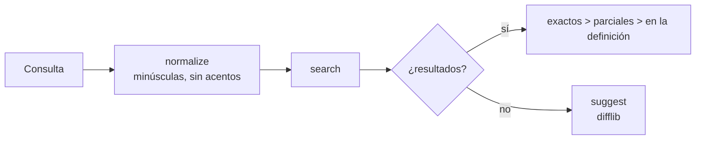

# 05 · Glosario interactivo

> Herramienta de laboratorio y aprendizaje. Consulta un archivo JSON local; no se conecta a nada.

Glosario de ciberseguridad en español con 43 términos en 9 categorías (fundamentos, ataques, malware, operaciones de seguridad, redes, correo, identidad, criptografía y vulnerabilidades). Busca **sin importar mayúsculas ni acentos**, reconoce sinónimos (`2fa` → MFA, `cortafuegos` → Firewall), ordena los resultados por relevancia y sugiere el término correcto si te equivocas al escribir (`fishing` → Phishing).

[← Volver al portafolio de ciberseguridad](../README.md) · Proyecto relacionado: [01 · Quiz de ciberseguridad](../01-quiz-ciberseguridad/README.md)

## Contenido

1. [Qué problema resuelve](#1-qué-problema-resuelve)
2. [Instalación desde cero](#2-instalación-desde-cero)
3. [Comandos](#3-comandos)
4. [Ejemplo de entrada y salida](#4-ejemplo-de-entrada-y-salida)
5. [Archivos y carpetas](#5-archivos-y-carpetas)
6. [Funciones principales y recorrido de los datos](#6-funciones-principales-y-recorrido-de-los-datos)
7. [Dependencias](#7-dependencias)
8. [Limitaciones y errores frecuentes](#8-limitaciones-y-errores-frecuentes)
9. [Pruebas](#9-pruebas)
10. [Ejercicios](#10-ejercicios)
11. [Preguntas de entrevista](#11-preguntas-de-entrevista)
12. [Guion de demostración](#12-guion-de-demostración)
13. [Capturas](#13-capturas)

## 1. Qué problema resuelve

Ciberseguridad tiene mucho vocabulario en inglés y siglas (SIEM, IOC, DMARC, EDR...). Un glosario propio, con ejemplos conectados a los demás proyectos del laboratorio, sirve para estudiar y para explicar conceptos con tus palabras en una entrevista. Como proyecto de programación practica normalización de texto (acentos y mayúsculas), búsqueda con prioridades y sugerencias por similitud.

## 2. Instalación desde cero

Requisitos: Python 3.10 o superior.

**Linux Mint**

```bash
cd Tipos-de-Proyectos/ciberseguridad/05-glosario
python3 -m venv .venv
source .venv/bin/activate
python -m pip install -r requirements-dev.txt
```

**Windows (PowerShell)**

```powershell
cd Tipos-de-Proyectos\ciberseguridad\05-glosario
py -m venv .venv
.\.venv\Scripts\Activate.ps1
python -m pip install -r requirements-dev.txt
```

## 3. Comandos

Ejecuta todo desde la carpeta `ciberseguridad/05-glosario`.

| Objetivo | Comando |
|---|---|
| Buscar un término | `python -m security_glossary siem` |
| Con acentos o sin ellos, da igual | `python -m security_glossary contencion` |
| Varias palabras | `python -m security_glossary ingeniería social` |
| Modo de consulta continua | `python -m security_glossary -i` (o sin argumentos) |
| Ver todos por categoría | `python -m security_glossary --list` |
| Solo una categoría | `python -m security_glossary --list --category correo` |
| Un término al azar para estudiar | `python -m security_glossary --random` |
| Validar el JSON después de editarlo | `python -m security_glossary --validate` |
| Pruebas | `python -m pytest` |

Códigos de salida: `0` encontrado o listado, `1` error del glosario, `2` argumentos inválidos, `3` sin resultados.

## 4. Ejemplo de entrada y salida

```text
$ python -m security_glossary 2fa
1 resultado(s) para '2fa':

MFA  [Identidad]
  También: 2FA, autenticación multifactor, doble factor
  Qué es: Pedir dos o más factores distintos para entrar: algo que sabes, algo que
          tienes, algo que eres.
  Ejemplo: Contraseña más un código TOTP del teléfono.
  Ver también: TOTP, Fuerza bruta

$ python -m security_glossary fishing
No encontré 'fishing'. ¿Quisiste decir: Phishing?
```

Formato de cada término en `data/glosario.json`:

```json
{"termino": "Password spraying", "categoria": "Ataques", "sinonimos": ["rociado de contraseñas"],
 "definicion": "Probar pocas contraseñas comunes contra muchas cuentas...",
 "ejemplo": "Una IP que falla una vez en 30 cuentas distintas en dos minutos.",
 "relacionados": ["Fuerza bruta", "SIEM"]}
```

## 5. Archivos y carpetas

```
05-glosario/
├── README.md
├── requirements.txt / requirements-dev.txt / pytest.ini
├── data/glosario.json        43 términos editables
├── security_glossary/
│   ├── __main__.py
│   ├── glossary.py           normalize, validate, search, suggest, by_category
│   └── cli.py                búsqueda, --list, --random, modo interactivo
├── tests/
└── docs/screenshots/
```

## 6. Funciones principales y recorrido de los datos



1. **`normalize`** descompone los caracteres con `unicodedata.normalize("NFKD")` y quita las marcas de acento, así `Contención` y `contencion` son iguales; también colapsa espacios.
2. **`search`** separa tres grupos y los devuelve en orden: coincidencia exacta con el término o un sinónimo, texto contenido en un nombre, texto en la definición o el ejemplo.
3. **`suggest`** usa `difflib.get_close_matches` sobre todos los nombres y sinónimos normalizados.
4. **`validate`** revisa campos obligatorios, términos repetidos y que cada "relacionado" exista, para que no haya enlaces rotos.

## 7. Dependencias

| Paquete | Para qué | Cuándo |
|---|---|---|
| Biblioteca estándar (`json`, `unicodedata`, `difflib`, `textwrap`) | todo | siempre |
| `pytest` | pruebas | solo desarrollo |

## 8. Limitaciones y errores frecuentes

**Limitaciones**

- La sugerencia compara caracteres, no significado: "contraseña robada" no sugiere "Fuerza bruta".
- Las definiciones son breves y de nivel introductorio; para profundizar están las fuentes oficiales (NIST, MITRE ATT&CK).
- Búsqueda lineal: perfecta para cientos de términos, no para millones.

**Errores frecuentes**

| Mensaje | Causa | Solución |
|---|---|---|
| `relacionados que no existen en el glosario` | un "relacionado" mal escrito o un término borrado | corrige el nombre o agrega el término |
| `término repetido` | el mismo término dos veces (aunque cambien mayúsculas o acentos) | deja uno |
| `no hay categoría ...` | nombre distinto | usa `--list` sin `--category` |

## 9. Pruebas

```bash
python -m pytest
python -m pytest -v
```

| Archivo | Qué comprueba |
|---|---|
| `test_glossary.py` | glosario válido, 8 búsquedas exactas por sinónimo o sin acentos, coincidencia parcial, orden de relevancia, consulta vacía, 3 sugerencias de errores de escritura, normalización, errores de validación y de lectura, interfaz con y sin resultados, `--max`, `--list`, `--random`, `--validate`, modo interactivo y fin de entrada, ejecución con `python -m` |

**Pruebas ejecutadas** al preparar esta entrega (Linux x86_64 en la nube, 24 de noviembre de 2026): `python -m pytest` → **24 passed** con Python 3.11 y 3.13.

**Pruebas pendientes de ejecutar por ti**: Linux Mint y Windows en tus equipos.

## 10. Ejercicios

1. **Tus términos.** Agrega 5 términos de lo que estés estudiando (por ejemplo, del certificado de Google o de Security+) con su ejemplo y relacionados, y ejecuta `--validate`.
2. **Modo tarjetas.** Agrega `--flashcards N` que muestre N definiciones al azar y pida escribir el término; usa `normalize` para comparar la respuesta.
3. **Exportar.** Agrega `--export-md glosario.md` que genere un Markdown ordenado por categoría con enlaces internos entre relacionados.

## 11. Preguntas de entrevista

**1. ¿Cómo haces que la búsqueda ignore acentos?**
Con `unicodedata.normalize("NFKD")`, que separa "ó" en "o" más un acento combinable; luego descarto los caracteres combinables y paso a minúsculas. Aplico lo mismo a la consulta y a los términos.

**2. ¿Por qué ordenas los resultados en grupos?**
Porque si busco "phishing" quiero primero el término Phishing, luego los que lo contienen en el nombre (Spear phishing) y al final los que solo lo mencionan. Ordenar solo alfabéticamente escondería el resultado más útil.

**3. ¿Qué hace `difflib.get_close_matches`?**
Calcula qué tan parecidas son dos cadenas (proporción de caracteres en común) y devuelve las que superan un umbral, ordenadas. Con 0.6 detecta errores de escritura comunes como "fishing" o "ransonware".

**4. ¿Por qué validas que los "relacionados" existan?**
Porque el glosario lo edita una persona y es fácil renombrar un término y dejar referencias rotas. La validación lo detecta antes de que alguien busque y no encuentre el relacionado.

## 12. Guion de demostración

Duración aproximada: 1 minuto y medio.

1. (15 s) "Este es el glosario de mi laboratorio: 43 términos con ejemplos conectados a mis otras herramientas."
2. (20 s) Busca `2fa` y `CONTENCION`: sinónimos y acentos.
3. (15 s) Busca `fishing`: sugerencia.
4. (20 s) Entra con `-i` y consulta `dmarc` y `ioc` seguidos.
5. (20 s) Muestra `--list --category "Operaciones de seguridad"` y cierra: "lo uso para estudiar y para explicar con mis palabras".

## 13. Capturas

Pendiente: agrega capturas reales después de ejecutar la herramienta en tu equipo y guárdalas en [`docs/screenshots/`](docs/screenshots/README.md).
