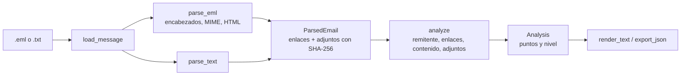

# 06 · Analizador de correos

> Herramienta de laboratorio y aprendizaje. Lee archivos `.eml` o mensajes de texto; **nunca abre enlaces ni adjuntos**.

Hace el triaje de un correo sospechoso: lee remitente, "Responder a", resultados SPF/DKIM/DMARC, enlaces (texto visible contra destino real) y adjuntos (nombre, tipo, tamaño y SHA-256 calculado en memoria). Suma puntos por cada indicador de phishing, explica cada uno con su **posible falso positivo** y da un nivel de riesgo con una recomendación. Los enlaces se muestran desactivados (`hxxps://dominio[.]com`), como en un reporte de SOC.

[← Volver al portafolio de ciberseguridad](../README.md) · Proyectos relacionados: [13 · Verificador de archivos sospechosos](../13-verificador-archivos/README.md), [08 · Generador de reportes](../08-generador-reportes/README.md)

## Contenido

1. [Qué problema resuelve](#1-qué-problema-resuelve)
2. [Instalación desde cero](#2-instalación-desde-cero)
3. [Comandos](#3-comandos)
4. [Ejemplo de entrada y salida](#4-ejemplo-de-entrada-y-salida)
5. [Archivos y carpetas](#5-archivos-y-carpetas)
6. [Funciones principales y recorrido de los datos](#6-funciones-principales-y-recorrido-de-los-datos)
7. [Dependencias](#7-dependencias)
8. [Limitaciones y errores frecuentes](#8-limitaciones-y-errores-frecuentes)
9. [Pruebas](#9-pruebas)
10. [Ejercicios](#10-ejercicios)
11. [Preguntas de entrevista](#11-preguntas-de-entrevista)
12. [Guion de demostración](#12-guion-de-demostración)
13. [Capturas](#13-capturas)

## 1. Qué problema resuelve

El phishing sigue siendo la puerta de entrada más común a una empresa. Cuando un usuario reporta "me llegó un correo raro", el equipo de soporte o el SOC necesita decidir rápido si es peligroso, sin abrir nada. Esta herramienta automatiza las revisiones que se hacen a mano: ¿el dominio imita al del banco?, ¿el texto del enlace dice una dirección y lleva a otra?, ¿el adjunto es `factura.pdf.exe`?, ¿falló SPF o DMARC?

Útil para:

- Practicar cómo está hecho un correo (encabezados, MIME, HTML, adjuntos).
- Explicar en una entrevista los indicadores de phishing y sus falsos positivos.
- Sacar URLs, dominios y hashes de adjuntos (indicadores de compromiso) en JSON para otras herramientas.

La puntuación **prioriza**; no prueba un fraude.

## 2. Instalación desde cero

Requisitos: Python 3.10 o superior.

**Linux Mint**

```bash
cd Tipos-de-Proyectos/ciberseguridad/06-analizador-correos
python3 -m venv .venv
source .venv/bin/activate
python -m pip install -r requirements-dev.txt
```

**Windows (PowerShell)**

```powershell
cd Tipos-de-Proyectos\ciberseguridad\06-analizador-correos
py -m venv .venv
.\.venv\Scripts\Activate.ps1
python -m pip install -r requirements-dev.txt
```

Para analizar un correo real: en Gmail, "Mostrar original" → "Descargar original"; en Outlook o Thunderbird, "Guardar como" `.eml`. **No subas correos reales al repositorio.**

## 3. Comandos

Ejecuta todo desde la carpeta `ciberseguridad/06-analizador-correos`.

| Objetivo | Comando |
|---|---|
| Analizar todos los ejemplos con resumen | `python -m email_analyzer samples` |
| Un correo | `python -m email_analyzer samples/02_phishing_banco.eml` |
| Un mensaje de texto (SMS, WhatsApp) | `python -m email_analyzer samples/05_sms_paqueteria.txt` |
| Forzar modo texto | `python -m email_analyzer pegado.eml --text` |
| Exportar indicadores (URLs, dominios, hashes) | `python -m email_analyzer samples --export-json output/iocs.json` |
| Usarlo en un script (código 3 si hay riesgo alto) | `python -m email_analyzer correo.eml --fail-on alto` |
| Marcas propias | `python -m email_analyzer correo.eml --config mis_marcas.json` |
| Pruebas | `python -m pytest` |

En `config/settings.json` se definen las marcas protegidas (`"Banco Fénix": ["bancofenix.example"]`), los acortadores y las frases de urgencia y de datos sensibles. Agrega los dominios reales de tu banco o tu empresa en tu copia local.

Códigos de salida: `0` correcto, `1` error (o ningún mensaje se pudo analizar), `2` argumentos inválidos, `3` nivel de `--fail-on` alcanzado.

### Indicadores y puntos

| Código | Puntos | Qué revisa |
|---|---|---|
| `AUTENTICACION_FALLA` | 10 por mecanismo | `spf`, `dkim` o `dmarc` = `fail`, `softfail`, `none` o `permerror` en `Authentication-Results` |
| `RESPONDER_A_DISTINTO` | 15 | `Reply-To` de otro dominio |
| `RETURN_PATH_DISTINTO` | 5 | sobre de otro dominio |
| `REMITENTE_PARECIDO` | 30 | dominio del remitente que imita a uno protegido (distancia de edición ≤ 2, `rn`→`m`, `1`/`i`→`l`, `0`→`o`, o que contiene la marca) |
| `NOMBRE_SUPLANTA_MARCA` / `NOMBRE_CON_OTRO_CORREO` | 20 | el nombre visible usa una marca o un correo que no corresponde |
| `ENLACE_ENGANOSO` | 30 | el texto del enlace muestra un dominio y el `href` lleva a otro |
| `ENLACE_PARECIDO` | 25 | el enlace imita un dominio protegido |
| `ENLACE_A_IP` | 20 | enlace a una dirección IP |
| `ENLACE_PUNYCODE` | 15 | dominio `xn--` |
| `ENLACE_ACORTADO`, `ENLACE_SIN_HTTPS` | 5 | destino oculto o sin cifrado |
| `URGENCIA` | 10 | "urgente", "24 horas", "será bloqueada"... |
| `PIDE_DATOS_SENSIBLES` | 15 | "contraseña", "NIP", "código de verificación"... |
| `ADJUNTO_DOBLE_EXTENSION` | 35 | `algo.pdf.exe` |
| `ADJUNTO_EJECUTABLE` | 25 | `.exe`, `.js`, `.vbs`, `.hta`, `.iso`, `.lnk`, `.docm`, `.one`... |
| `ADJUNTO_HTML` | 15 | página web adjunta (suele imitar un inicio de sesión) |

Nivel: 0-24 **BAJO**, 25-59 **MEDIO**, 60-100 **ALTO** (tope 100).

## 4. Ejemplo de entrada y salida

Los 6 ejemplos de `samples/` son sintéticos y usan el dominio reservado `.example` (RFC 2606) e IPs de documentación (RFC 5737). Ver [samples/README.md](samples/README.md).

```bash
python -m email_analyzer samples/02_phishing_banco.eml
```

Salida real:

```text
Analizador de correos - Cybersecurity Python Lab
================================================

Archivo: samples/02_phishing_banco.eml  (correo .eml)
  De:         Banco Fénix Seguridad <seguridad@bancofenlx.example>
  Responder a: soporte.bancofenix@correo-gratis.example
  Asunto:     URGENTE: su cuenta será bloqueada en 24 horas
  Autenticación: dkim=none, dmarc=fail, spf=fail
  Enlaces (1, desactivados):
    - texto 'https://www.bancofenix.example/seguridad' -> hxxp://198[.]51[.]100[.]77/bancofenix/login.php
  Indicadores (9):
    +30  AUTENTICACION_FALLA: el servidor receptor registró dkim=none, dmarc=fail, spf=fail
         Posible falso positivo: reenvíos y listas de correo rompen SPF o DKIM; DMARC=pass compensa
    +15  RESPONDER_A_DISTINTO: las respuestas irían a soporte.bancofenix@correo-gratis.example, no al dominio del remitente (bancofenlx.example)
         Posible falso positivo: algunas empresas usan un sistema de soporte con otro dominio
    +5   RETURN_PATH_DISTINTO: el sobre (Return-Path) es envios@masivo-barato.example
         Posible falso positivo: los servicios de envío masivo usan su propio dominio en el Return-Path
    +30  REMITENTE_PARECIDO: el dominio bancofenlx.example se parece a bancofenix.example (Banco Fénix) pero no es el mismo
         Posible falso positivo: una marca puede registrar dominios parecidos para campañas; confirma en su sitio oficial
    +20  NOMBRE_SUPLANTA_MARCA: el nombre visible dice 'Banco Fénix Seguridad' pero el dominio bancofenlx.example no es de Banco Fénix
         Posible falso positivo: un proveedor autorizado podría escribir a nombre de la marca
    +30  ENLACE_ENGANOSO: el texto muestra www.bancofenix.example pero el enlace lleva a 198.51.100.77
         Posible falso positivo: algunos boletines usan un dominio de rastreo de clics
    +20  ENLACE_A_IP: el enlace usa una dirección IP en vez de un dominio: 198.51.100.77
         Posible falso positivo: raro en correos legítimos dirigidos a clientes
    +10  URGENCIA: lenguaje de presión: 'urgente', '24 horas', 'será bloqueada'
         Posible falso positivo: avisos reales de vencimiento también usan fechas límite
    +15  PIDE_DATOS_SENSIBLES: menciona datos sensibles: 'contraseña', 'nip', 'código de verificación', 'usuario y contraseña'
         Posible falso positivo: un correo legítimo puede recordarte NO compartirlos; lee el contexto
  Puntuación: 100/100 -> riesgo ALTO
  Recomendación: No hagas clic ni abras adjuntos. Reporta el correo al equipo de seguridad y bloquea el remitente y los enlaces.
```

Con la carpeta completa (`python -m email_analyzer samples`) se agrega un resumen ordenado por puntuación:

```text
Resumen
  02_phishing_banco.eml          100/100  ALTO
  03_factura_con_adjunto.eml      60/100  ALTO
  05_sms_paqueteria.txt           55/100  MEDIO
  01_legitimo_estado_cuenta.eml   15/100  BAJO
  04_boletin_acortador.eml         5/100  BAJO

No analizado: samples/06_no_es_correo.eml  samples/06_no_es_correo.eml no tiene encabezados de correo (From, Subject...). Usa --text para mensajes sueltos
```

Observa los falsos positivos controlados: el correo legítimo del banco suma 15 puntos porque dice "nunca te pediremos tu contraseña", y el boletín suma 5 por usar un acortador; ambos quedan en BAJO.

## 5. Archivos y carpetas

```
06-analizador-correos/
├── README.md
├── requirements.txt / requirements-dev.txt / pytest.ini
├── config/settings.json     marcas protegidas, acortadores y frases
├── email_analyzer/
│   ├── __main__.py
│   ├── cli.py               argumentos, carpetas, --fail-on, códigos de salida
│   ├── config.py            lee y valida la configuración
│   ├── parser.py            .eml (MIME, HTML, adjuntos) y texto; defang de URLs
│   ├── indicators.py        reglas, dominios parecidos, puntuación y nivel
│   └── report.py            reporte de triaje y exportación de indicadores
├── samples/                 6 mensajes sintéticos
├── tests/
└── docs/screenshots/
```

## 6. Funciones principales y recorrido de los datos



1. **`parse_eml`** usa `BytesParser(policy=policy.default)`, que decodifica encabezados `=?utf-8?...?=` y cuerpos base64. Recorre las partes MIME: las partes con nombre o `Content-Disposition: attachment` son adjuntos (se mide su tamaño y SHA-256 en memoria); el HTML pasa por `_LinkCollector` (un `HTMLParser`) que guarda cada `<a href>` con su texto visible e ignora `<script>` y `<style>`.
2. **`analyze`** aplica las reglas. `registrable_domain` aproxima el dominio registrable (`login.banco.com.mx` → `banco.com.mx`) para no marcar subdominios legítimos. `lookalike_of` combina distancia de Levenshtein, una "forma visual" de la etiqueta (`rn`→`m`, `1`→`l`) y la presencia de la marca dentro de otro dominio.
3. **`contains_phrase`** busca frases completas sin acentos ni mayúsculas, para que "pin" no coincida con "opinión".
4. **`report`** desactiva URLs con `defang`, escapa caracteres de control del asunto o del texto y exporta URLs, dominios y hashes en JSON.

## 7. Dependencias

| Paquete | Para qué | Cuándo |
|---|---|---|
| Biblioteca estándar (`email`, `html.parser`, `urllib.parse`, `ipaddress`, `hashlib`, `unicodedata`) | todo | siempre |
| `pytest` | pruebas | solo desarrollo |

## 8. Limitaciones y errores frecuentes

**Limitaciones**

- Depende de `Authentication-Results`: si el servidor no lo agrega (o lo agregó un servidor intermedio no confiable), la autenticación no se puede evaluar.
- No sigue redirecciones ni visita enlaces (a propósito): un acortador o un dominio nuevo pueden ocultar el destino real.
- La detección de dominios parecidos solo compara contra las marcas de la configuración.
- `registrable_domain` es una aproximación; la lista completa de sufijos públicos (Public Suffix List) sería más exacta.
- Las frases están en español e inglés básico; un correo en otro idioma solo se evalúa por enlaces, remitente y adjuntos.

**Errores frecuentes**

| Mensaje | Causa | Solución |
|---|---|---|
| `no tiene encabezados de correo` | el archivo es solo texto | usa `--text` |
| `'protected_domains' debe ser ...` | configuración con formato incorrecto | revisa que cada marca tenga una lista de dominios con punto |
| Caracteres raros en el asunto | correo con codificación dañada | se muestran escapados; el análisis sigue |

## 9. Pruebas

```bash
python -m pytest
python -m pytest -v
```

| Archivo | Qué comprueba |
|---|---|
| `test_indicators.py` | dominio registrable, Levenshtein, 6 dominios parecidos y 4 que no lo son, frases sin acentos y por palabra completa, defang, encabezados codificados, enlaces del HTML, adjuntos con hash sin guardarlos, `<script>` ignorado, archivo sin encabezados, puntuación exacta de los 5 ejemplos, indicadores del phishing, casos legítimos que no deben marcarse |
| `test_cli.py` | resumen de carpeta y errores, enlaces desactivados, `--text`, `--fail-on`, exportación de indicadores y `--force`, configuración inválida, asunto con secuencias ANSI, ejecución con `python -m` |

**Pruebas ejecutadas** al preparar esta entrega (Linux x86_64 en la nube, 24 de noviembre de 2026): `python -m pytest` → **42 passed** con Python 3.11 y 3.13.

**Pruebas pendientes de ejecutar por ti**: Linux Mint y Windows en tus equipos.

## 10. Ejercicios

1. **Ruta de servidores.** Lee los encabezados `Received` (de abajo hacia arriba) y muestra la IP del primer servidor externo. Agrega un indicador si esa IP es privada o si los saltos tienen fechas desordenadas.
2. **Lista de sufijos públicos.** Sustituye `registrable_domain` por una versión que lea un archivo local con sufijos como `com.mx`, `gob.mx`, `co.uk` y prueba con `bancofenix.co.uk`.
3. **Integración con el proyecto 13.** Agrega `--save-attachments CARPETA` que guarde los adjuntos **con un nombre seguro y extensión `.bin`** (para que no se puedan abrir con doble clic) y después analízalos con `python -m file_inspector`.

## 11. Preguntas de entrevista

**1. ¿Qué son SPF, DKIM y DMARC?**
SPF dice qué servidores pueden enviar correo de un dominio; DKIM firma el mensaje para comprobar que no se alteró; DMARC une ambos con el dominio visible del `From` y dice qué hacer si fallan. Un `dmarc=fail` en un correo que dice ser del banco es una señal fuerte, pero un reenvío puede romper SPF, por eso lo trato como un indicador más.

**2. ¿Por qué comparas el texto del enlace con su destino?**
Porque en HTML el texto visible y el `href` son independientes: puedo escribir "https://www.bancofenix.example" y llevar a una IP. Es una de las técnicas más comunes y de las más fáciles de detectar automáticamente.

**3. ¿Cómo detectas un dominio parecido?**
Comparo la etiqueta principal con los dominios protegidos: distancia de edición de 2 o menos (`bancofenlx`), una forma "visual" que convierte `rn` en `m` o `1` en `l`, y si la marca aparece dentro de otro dominio (`bancofenix-seguridad.example`). Excluyo el dominio legítimo y sus subdominios.

**4. ¿Por qué cada indicador trae un "posible falso positivo"?**
Porque el analista tiene que tomar la decisión final y necesita saber cuándo una regla se equivoca: los boletines usan acortadores, un correo legítimo puede decir "nunca te pediremos tu contraseña". Un sistema que solo da un número sin contexto genera alertas que la gente aprende a ignorar.

**5. ¿Qué riesgos tiene analizar un correo malicioso?**
Abrir un enlace confirma al atacante que el correo llegó; abrir un adjunto puede ejecutar código. Por eso no visito nada, no guardo adjuntos (solo calculo su hash en memoria), desactivo las URLs en el reporte y escapo caracteres de control del asunto.

## 12. Guion de demostración

Duración aproximada: 2 minutos y medio.

1. (15 s) "Este es el analizador de correos de mi laboratorio: el triaje que hace un analista cuando un usuario reporta phishing."
2. (20 s) Abre `samples/02_phishing_banco.eml` en un editor: señala `From`, `Reply-To`, `Authentication-Results` y el `<a href>`.
3. (40 s) Ejecuta `python -m email_analyzer samples/02_phishing_banco.eml` y recorre los 9 indicadores: dominio `bancofenlx`, texto del enlace contra la IP, DMARC fallido.
4. (20 s) Señala que los enlaces salen como `hxxp://198[.]51...`: "así nadie lo abre por error al copiar el reporte".
5. (25 s) Ejecuta `python -m email_analyzer samples` y explica el resumen: el legítimo y el boletín quedan en BAJO aunque tienen un indicador cada uno.
6. (20 s) Exporta con `--export-json output/iocs.json` y muestra los hashes de los adjuntos: "estos indicadores pasan al proyecto 13 o a una lista de bloqueo". Cierra: "la puntuación prioriza; la decisión es del analista".

## 13. Capturas

Pendiente: agrega capturas reales después de ejecutar la herramienta en tu equipo y guárdalas en [`docs/screenshots/`](docs/screenshots/README.md).
