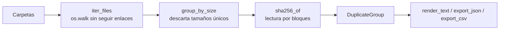

# 07 · Buscador de archivos duplicados

> Herramienta de laboratorio y aprendizaje. Solo lee archivos locales; nunca borra, mueve ni modifica nada.

Agrupa archivos idénticos comparando primero el tamaño y después la huella SHA-256 calculada por bloques. Muestra cuánto espacio ocupan las copias sobrantes y exporta el resultado a JSON o CSV.

[← Volver al portafolio de ciberseguridad](../README.md) · Proyecto relacionado: [13 · Verificador de archivos sospechosos](../13-verificador-archivos/README.md)

## Contenido

1. [Qué problema resuelve](#1-qué-problema-resuelve)
2. [Instalación desde cero](#2-instalación-desde-cero)
3. [Comandos](#3-comandos)
4. [Ejemplo de entrada y salida](#4-ejemplo-de-entrada-y-salida)
5. [Archivos y carpetas](#5-archivos-y-carpetas)
6. [Funciones principales y recorrido de los datos](#6-funciones-principales-y-recorrido-de-los-datos)
7. [Dependencias](#7-dependencias)
8. [Limitaciones y errores frecuentes](#8-limitaciones-y-errores-frecuentes)
9. [Pruebas](#9-pruebas)
10. [Ejercicios](#10-ejercicios)
11. [Preguntas de entrevista](#11-preguntas-de-entrevista)
12. [Guion de demostración](#12-guion-de-demostración)
13. [Capturas](#13-capturas)

## 1. Qué problema resuelve

Las copias repetidas llenan discos, respaldos y carpetas compartidas, y en seguridad también importan: el mismo archivo con distinto nombre en varias carpetas puede ser un documento filtrado copiado varias veces o un mismo malware guardado como `factura.pdf` y `foto.jpg`. Comparar por nombre no sirve; hay que comparar el **contenido**.

Útil para:

- Practicar huellas criptográficas (hash) y por qué SHA-256 identifica contenido.
- Limpiar una carpeta de descargas o respaldos sabiendo exactamente qué es igual a qué.
- Agrupar evidencia repetida antes de analizarla con el [proyecto 13](../13-verificador-archivos/README.md).

No borra nada: decidir qué copia conservar es tarea de una persona.

## 2. Instalación desde cero

Requisitos: Python 3.10 o superior.

**Linux Mint**

```bash
cd Tipos-de-Proyectos/ciberseguridad/07-buscador-duplicados
python3 -m venv .venv
source .venv/bin/activate
python -m pip install -r requirements-dev.txt
```

**Windows (PowerShell)**

```powershell
cd Tipos-de-Proyectos\ciberseguridad\07-buscador-duplicados
py -m venv .venv
.\.venv\Scripts\Activate.ps1
python -m pip install -r requirements-dev.txt
```

La herramienta solo usa la biblioteca estándar; `requirements-dev.txt` instala `pytest` para las pruebas.

## 3. Comandos

Ejecuta todo desde la carpeta `ciberseguridad/07-buscador-duplicados`.

| Objetivo | Comando |
|---|---|
| Revisar la carpeta de ejemplo | `python -m duplicate_finder samples/carpeta_demo` |
| Incluir archivos y carpetas ocultos | `python -m duplicate_finder samples/carpeta_demo --include-hidden` |
| Incluir archivos vacíos | `python -m duplicate_finder samples/carpeta_demo --min-size 0` |
| Ignorar archivos menores a 1 MiB | `python -m duplicate_finder ~/Descargas --min-size 1048576` |
| Varias carpetas a la vez | `python -m duplicate_finder carpetaA carpetaB` |
| Exportar | `python -m duplicate_finder samples/carpeta_demo --export-json output/dup.json --export-csv output/dup.csv` |
| Ayuda | `python -m duplicate_finder --help` |
| Pruebas | `python -m pytest` |

| Opción | Uso | Valor por defecto |
|---|---|---|
| `--min-size` | ignora archivos más pequeños (en bytes) | `1` (los vacíos no ocupan espacio) |
| `--include-hidden` | revisa nombres que empiezan con `.` y archivos con atributo oculto de Windows | no |
| `--top` | grupos a mostrar; `0` = todos | `20` |
| `--export-json`, `--export-csv` | guarda el resultado | — |
| `--force` | permite sobrescribir exportaciones | no |
| `--config` | otro archivo de configuración | `config/settings.json` |

Códigos de salida: `0` correcto (haya o no duplicados), `1` error de entrada, configuración o exportación, `2` argumentos inválidos.

## 4. Ejemplo de entrada y salida

`samples/carpeta_demo/` tiene 10 archivos sintéticos (ver [samples/README.md](samples/README.md)): un reporte copiado 3 veces (más una cuarta copia en una carpeta oculta), un logo copiado 2 veces, dos notas **del mismo tamaño pero distinto contenido** y dos archivos vacíos.

```bash
python -m duplicate_finder samples/carpeta_demo
```

Salida real:

```text
Buscador de archivos duplicados - Cybersecurity Python Lab
==========================================================

Carpetas revisadas: samples/carpeta_demo
Archivos considerados: 7 (458 B) | tamaño mínimo: 1 B
Archivos con tamaño repetido, comparados por SHA-256: 7
Grupos de duplicados: 2 | copias sobrantes: 3 | espacio recuperable: 240 B

Grupo 1: 3 archivos de 70 B (sobran 140 B)
  SHA-256: cb4b3e21258d986422266df9bc5eca9bb84f9b0bbfe57b429ccacabc9ca265e0
  - samples/carpeta_demo/documentos/copia de reporte_q3.txt
  - samples/carpeta_demo/documentos/reporte_q3.txt
  - samples/carpeta_demo/respaldo/reporte_final.txt

Grupo 2: 2 archivos de 100 B (sobran 100 B)
  SHA-256: ade38c8ba07ffcc0c23ae204abdb1ee3d6aecc2211e7bdeb1c95754eb8795961
  - samples/carpeta_demo/imagenes/logo.svg
  - samples/carpeta_demo/respaldo/logo (copia).svg

Nota: esta herramienta no borra nada. Revisa cada grupo y decide tú qué copia conservar.
```

Observa:

- `notas.txt` y `notas_viejas.txt` miden 24 B, así que se compararon por SHA-256, pero no son iguales y no forman grupo. Por eso el tamaño solo sirve como filtro.
- Con `--include-hidden` aparece la cuarta copia en `.cache/` y con `--min-size 0` aparece el grupo de archivos vacíos.
- En Windows las rutas se muestran con `\`.

## 5. Archivos y carpetas

```
07-buscador-duplicados/
├── README.md                 este documento
├── requirements.txt          sin dependencias externas
├── requirements-dev.txt      + pytest
├── pytest.ini
├── config/settings.json      tamaño mínimo, ocultos, tamaño de bloque y top
├── duplicate_finder/
│   ├── __main__.py           permite "python -m duplicate_finder"
│   ├── cli.py                argumentos, errores y códigos de salida
│   ├── config.py             lee y valida config/settings.json
│   ├── scanner.py            recorrido, agrupación por tamaño, SHA-256 por bloques
│   └── report.py             texto, JSON, CSV y limpieza de texto no confiable
├── samples/
│   ├── README.md             qué contiene cada archivo de ejemplo
│   ├── .gitattributes        evita que Git cambie los saltos de línea (y los hashes) en Windows
│   └── carpeta_demo/         10 archivos sintéticos
├── tests/                    pruebas automáticas
└── docs/screenshots/         aquí van tus capturas reales
```

## 6. Funciones principales y recorrido de los datos



1. **`scanner.iter_files`** recorre con `os.walk(followlinks=False)`. Anota solo ruta y tamaño (`lstat`), salta ocultos si no se piden, no sigue enlaces simbólicos y cuenta un archivo físico una sola vez aunque las carpetas se traslapen o haya enlaces duros (mismo dispositivo e inodo).
2. **`group_by_size`** conserva solo los tamaños repetidos: un archivo de tamaño único no puede tener duplicado y nunca se lee.
3. **`sha256_of`** lee en bloques de 1 MiB (`block_size`), así que la memoria no depende del tamaño del archivo.
4. **`find_duplicates`** agrupa por huella y ordena los grupos por espacio desperdiciado. Lo que no se puede leer va a `skipped` con su motivo; no detiene el análisis.
5. **`report`** escapa caracteres de control en la terminal (`clean_text`) y neutraliza fórmulas en el CSV (`safe_csv_cell`).

## 7. Dependencias

| Paquete | Para qué | Cuándo |
|---|---|---|
| Biblioteca estándar (`hashlib`, `os`, `stat`, `pathlib`, `csv`, `json`, `argparse`) | todo | siempre |
| `pytest` | pruebas | solo desarrollo |

## 8. Limitaciones y errores frecuentes

**Limitaciones**

- Compara contenido exacto: dos fotos iguales con distinta compresión o una letra distinta en un documento **no** son duplicados.
- Un archivo que cambia mientras se revisa puede dar un resultado desactualizado.
- No sigue enlaces simbólicos (por seguridad); los reporta como no revisados.
- En carpetas enormes la lista de archivos se guarda en memoria (solo ruta y tamaño).
- SHA-256 no tiene colisiones conocidas; aun así, la herramienta no borra nada y la decisión final es tuya.

**Errores frecuentes**

| Mensaje | Causa | Solución |
|---|---|---|
| `No existe: ...` | ruta mal escrita | revisa la ruta o usa comillas si tiene espacios |
| `no se pudo leer la carpeta: Permission denied` | carpeta del sistema o de otro usuario | revisa tus propias carpetas; no uses `sudo` ni "Ejecutar como administrador" |
| `... ya existe. Usa --force` | protección contra sobrescritura | cambia el nombre o agrega `--force` |
| `ModuleNotFoundError: duplicate_finder` | ejecutas desde otra carpeta | entra a `ciberseguridad/07-buscador-duplicados` |

## 9. Pruebas

```bash
python -m pytest            # todas
python -m pytest -v         # con el nombre de cada prueba
```

| Archivo | Qué comprueba |
|---|---|
| `test_scanner.py` | SHA-256 por bloques igual a `hashlib`, mismo tamaño con distinto contenido, tamaños únicos nunca leídos, archivos vacíos, ocultos, carpetas traslapadas, enlaces simbólicos, archivo ilegible, orden de grupos y los conteos exactos del ejemplo |
| `test_cli.py` | salida, `--top`, exportaciones, protección contra sobrescritura, errores de entrada y configuración, nombre de archivo malicioso en el CSV, ejecución con `python -m` |

**Pruebas ejecutadas** al preparar esta entrega (Linux x86_64 en la nube, 24 de noviembre de 2026): `python -m pytest` → **29 passed** con Python 3.11 y 3.13.

**Pruebas pendientes de ejecutar por ti**: Linux Mint y Windows en tus equipos.

## 10. Ejercicios

1. **Huella parcial primero.** Antes del SHA-256 completo, compara el hash de los primeros 4 KiB de cada candidato y descarta los que difieran. Mide con `time` cuánto se acelera en una carpeta con videos grandes del mismo tamaño.
2. **Lista de "conservar".** Agrega `--keep-prefer RUTA` para marcar en el reporte qué copia conviene conservar (la que está dentro de esa ruta). Sigue sin borrar nada.
3. **Comparar contra una lista de hashes.** Lee un archivo con hashes SHA-256 conocidos (por ejemplo, de malware de laboratorio) y marca los archivos que coincidan. Compáralo con lo que hace el proyecto 13.

## 11. Preguntas de entrevista

**1. ¿Por qué agrupas por tamaño antes de calcular hashes?**
Porque calcular SHA-256 obliga a leer todo el archivo y leer es lo más lento. Si dos archivos tienen distinto tamaño no pueden ser iguales, así que en una carpeta normal la mayoría se descarta sin leer un solo byte. Una prueba lo verifica sustituyendo la función de hash.

**2. ¿Por qué SHA-256 y no MD5?**
MD5 tiene colisiones prácticas: se pueden fabricar dos archivos distintos con el mismo MD5. Para decidir si dos archivos son iguales en un contexto de seguridad uso SHA-256, que no tiene colisiones conocidas. MD5 sigue apareciendo en listas de indicadores antiguas, por eso el proyecto 13 también lo muestra, pero no lo uso para decidir.

**3. ¿Por qué lees por bloques?**
`read()` sin tamaño carga el archivo completo en memoria; con un archivo de 8 GB el equipo se queda sin RAM. Leyendo bloques de 1 MiB y actualizando el hash, la memoria es constante.

**4. ¿Qué riesgos tiene una herramienta que solo lee?**
Seguir enlaces simbólicos podría salir de la carpeta elegida o entrar en un ciclo infinito, por eso no los sigo. Los nombres de archivo los elige quien crea el archivo: pueden contener secuencias ANSI o empezar con `=`, así que se escapan en la terminal y se neutralizan en el CSV. Y no borro nada: un error en la lógica no puede destruir datos.

**5. Si dos carpetas de entrada se traslapan, ¿no reportas cada archivo como duplicado de sí mismo?**
No: identifico cada archivo por dispositivo e inodo (y por ruta resuelta), y lo cuento una sola vez. Lo mismo pasa con enlaces duros, que son el mismo archivo físico con dos nombres.

## 12. Guion de demostración

Duración aproximada: 2 minutos.

1. (15 s) "Este es el buscador de duplicados de mi laboratorio. Compara contenido, no nombres, y no borra nada."
2. (20 s) Muestra `samples/carpeta_demo` en el explorador: nombres distintos (`reporte_final.txt`, `copia de reporte_q3.txt`).
3. (30 s) Ejecuta `python -m duplicate_finder samples/carpeta_demo` y explica los dos grupos y el espacio recuperable.
4. (20 s) Señala `notas.txt` y `notas_viejas.txt`: "mismo tamaño, distinto contenido; el tamaño solo es un filtro".
5. (20 s) Ejecuta con `--include-hidden --min-size 0` y muestra la copia oculta y el grupo de vacíos.
6. (15 s) Exporta a CSV y ábrelo en una hoja de cálculo. Cierra: "la decisión de borrar es humana; la herramienta da la evidencia".

## 13. Capturas

Pendiente: agrega capturas reales después de ejecutar la herramienta en tu equipo y guárdalas en [`docs/screenshots/`](docs/screenshots/README.md).
