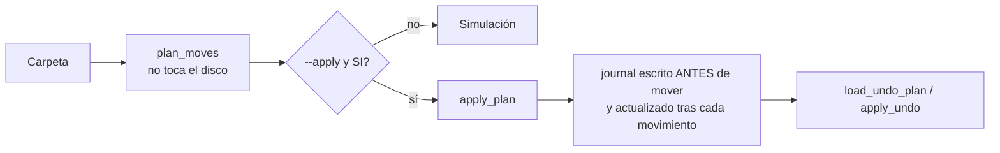

# 10 · Clasificador de archivos

> Herramienta de laboratorio y aprendizaje. **Por defecto solo simula.** Mueve archivos únicamente con `--apply` y confirmación, nunca sobrescribe y guarda un journal para revertir.

Organiza los archivos del primer nivel de una carpeta (por ejemplo, Descargas) en subcarpetas por tipo: `Imagenes`, `Documentos`, `Hojas de calculo`... Muestra el plan antes de tocar nada, resuelve choques de nombre con `nombre (1).ext` y permite deshacer todo con `--undo`.

[← Volver al portafolio de ciberseguridad](../README.md) · Proyecto relacionado: [03 · Validador de archivos](../03-validador-archivos/README.md)

## Contenido

1. [Qué problema resuelve](#1-qué-problema-resuelve)
2. [Instalación desde cero](#2-instalación-desde-cero)
3. [Comandos](#3-comandos)
4. [Ejemplo de entrada y salida](#4-ejemplo-de-entrada-y-salida)
5. [Archivos y carpetas](#5-archivos-y-carpetas)
6. [Funciones principales y recorrido de los datos](#6-funciones-principales-y-recorrido-de-los-datos)
7. [Dependencias](#7-dependencias)
8. [Limitaciones y errores frecuentes](#8-limitaciones-y-errores-frecuentes)
9. [Pruebas](#9-pruebas)
10. [Ejercicios](#10-ejercicios)
11. [Preguntas de entrevista](#11-preguntas-de-entrevista)
12. [Guion de demostración](#12-guion-de-demostración)
13. [Capturas](#13-capturas)

## 1. Qué problema resuelve

Ordenar una carpeta es fácil; ordenarla **sin perder nada** no lo es. Un script descuidado sobrescribe `foto.jpg` con otra `foto.jpg`, mueve archivos de sistema o deja todo a medias si falla. Este proyecto practica operaciones de archivos seguras: simular primero, confirmar, no sobrescribir, registrar cada cambio y poder revertir. Son las mismas ideas que se esperan de cualquier automatización que toque datos en producción.

## 2. Instalación desde cero

Requisitos: Python 3.10 o superior.

**Linux Mint**

```bash
cd Tipos-de-Proyectos/ciberseguridad/10-clasificador-archivos
python3 -m venv .venv
source .venv/bin/activate
python -m pip install -r requirements-dev.txt
```

**Windows (PowerShell)**

```powershell
cd Tipos-de-Proyectos\ciberseguridad\10-clasificador-archivos
py -m venv .venv
.\.venv\Scripts\Activate.ps1
python -m pip install -r requirements-dev.txt
```

## 3. Comandos

Ejecuta todo desde la carpeta `ciberseguridad/10-clasificador-archivos`.

| Objetivo | Comando |
|---|---|
| Demostración completa sobre una copia temporal | `python -m file_organizer --demo` |
| Ver qué haría (simulación, no mueve nada) | `python -m file_organizer samples/descargas_demo` |
| Organizar de verdad (pide escribir SI) | `python -m file_organizer RUTA --apply` |
| Organizar sin preguntar (scripts) | `python -m file_organizer RUTA --apply --yes` |
| Ver qué revertiría | `python -m file_organizer --undo RUTA/.organizador_journal_AAAAMMDD-HHMMSS.json` |
| Revertir | `python -m file_organizer --undo RUTA/.organizador_journal_....json --apply` |
| Categorías propias | `python -m file_organizer RUTA --config mis_categorias.json` |
| Pruebas | `python -m pytest` |

**No uses `--apply` sobre `samples/descargas_demo`**: son los datos de ejemplo del repositorio. Para practicar, copia la carpeta a otro lugar o usa `--demo`.

Las categorías están en `config/settings.json` (`"categories": {"Imagenes": [".jpg", ...]}`); lo que no coincide va a `Otros`.

Códigos de salida: `0` correcto o cancelado, `1` error, `2` argumentos inválidos, `3` algún movimiento falló.

## 4. Ejemplo de entrada y salida

```bash
python -m file_organizer samples/descargas_demo
```

Salida real:

```text
Carpeta: samples/descargas_demo

Movimientos planeados: 13
  archivo.desconocido       ->  Otros/archivo.desconocido
  cancion_demo.mp3          ->  Audio/cancion_demo.mp3
  captura_pantalla.png      ->  Imagenes/captura_pantalla.png
  clientes.csv              ->  Hojas de calculo/clientes.csv
  curriculum.docx           ->  Documentos/curriculum.docx
  Factura_Octubre.pdf       ->  Documentos/Factura_Octubre.pdf
  instalador_app.deb        ->  Instaladores y ejecutables/instalador_app.deb
  notas_sin_extension       ->  Otros/notas_sin_extension
  presentacion_ventas.pptx  ->  Presentaciones/presentacion_ventas.pptx
  presupuesto_2026.xlsx     ->  Hojas de calculo/presupuesto_2026.xlsx
  respaldo_fotos.zip        ->  Comprimidos/respaldo_fotos.zip
  script_respaldo.py        ->  Codigo/script_respaldo.py
  vacaciones_playa.jpg      ->  Imagenes/vacaciones_playa (1).jpg   (renombrado: el nombre ya existía)

Se quedan donde están: 1
  .configuracion_oculta  (archivo oculto (no se mueve))

Simulación: no se movió nada. Para aplicar agrega --apply.
```

Observa: ya existía `Imagenes/vacaciones_playa.jpg`, así que el archivo nuevo se renombra en lugar de sobrescribirlo. La carpeta `Proyectos/` no aparece porque las carpetas no se mueven.

`python -m file_organizer --demo` hace el ciclo completo sobre una copia temporal: antes, simulación, aplicar, después, revertir con el journal y comprobar que todo volvió a su lugar.

## 5. Archivos y carpetas

```
10-clasificador-archivos/
├── README.md
├── requirements.txt / requirements-dev.txt / pytest.ini
├── config/settings.json      categorías y extensiones
├── file_organizer/
│   ├── __main__.py
│   ├── cli.py                simulación, confirmación, --undo, --demo
│   └── organizer.py          plan_moves, apply_plan, load_undo_plan, apply_undo, tree
├── samples/
│   ├── README.md
│   └── descargas_demo/       15 archivos sintéticos y 2 carpetas
├── tests/
└── docs/screenshots/
```

## 6. Funciones principales y recorrido de los datos



1. **`plan_moves`** recorre solo el primer nivel; salta carpetas, ocultos y enlaces simbólicos; calcula destino con `category_for` y reserva nombres ya ocupados (comparando sin mayúsculas) para no sobrescribir.
2. **`apply_plan`** escribe el journal completo con estado `pendiente`, mueve con `os.rename` (misma unidad: no copia datos) comprobando antes que el destino no exista, y marca cada movimiento `hecho` o `fallido`. El journal se escribe de forma atómica (temporal + `os.replace`).
3. **`load_undo_plan`** lee el journal, invierte los movimientos `hecho` y descarta los que no se pueden deshacer sin pisar algo (destino ocupado u origen desaparecido).
4. **`apply_undo`** devuelve los archivos, elimina solo carpetas que quedaron **vacías** (`rmdir` nunca borra archivos) y renombra el journal a `.revertido.json`.

## 7. Dependencias

| Paquete | Para qué | Cuándo |
|---|---|---|
| Biblioteca estándar (`os`, `pathlib`, `shutil`, `json`, `tempfile`) | todo | siempre |
| `pytest` | pruebas | solo desarrollo |

## 8. Limitaciones y errores frecuentes

**Limitaciones**

- Clasifica por extensión, no por contenido (el [proyecto 03](../03-validador-archivos/README.md) compara ambas).
- Solo el primer nivel de la carpeta; no reorganiza subcarpetas.
- Entre comprobar que el destino está libre y mover hay un instante en que otro programa podría crear ese archivo; en Linux `os.rename` lo sobrescribiría. Para una carpeta personal el riesgo es mínimo; en un servidor compartido se usaría un bloqueo.
- Si mueves o borras archivos después de organizar, el undo los reporta y no los inventa.

**Errores frecuentes**

| Mensaje | Causa | Solución |
|---|---|---|
| `--yes solo tiene sentido junto con --apply` | `--yes` sin `--apply` | agrega `--apply` o quita `--yes` |
| `indica una CARPETA, o --undo JOURNAL, o --demo (solo uno)` | combinaste modos | usa uno a la vez |
| `la extensión .pdf está en dos categorías` | configuración repetida | deja cada extensión en una sola categoría |
| `NO SE PUEDE ...: el lugar original está ocupado` | creaste otro archivo con ese nombre después de organizar | renómbralo y vuelve a ejecutar el undo |
| `PermissionError` al aplicar | archivo abierto en otro programa (Windows) | ciérralo; los demás movimientos sí se hacen y quedan en el journal |

## 9. Pruebas

```bash
python -m pytest
python -m pytest -v
```

| Archivo | Qué comprueba |
|---|---|
| `test_organizer.py` | categorías, extensión repetida, el plan no toca el disco, ocultos/carpetas/enlaces, choques de nombre sin sobrescribir, reutilizar carpeta con otra capitalización, journal + undo completo, undo que no pisa archivos, archivos desaparecidos, movimiento fallido registrado, journal dañado, plan exacto de los ejemplos |
| `test_cli.py` | simulación por defecto, cancelar sin escribir SI o con fin de entrada, ida y vuelta con `--apply` y `--undo`, combinaciones inválidas, configuración inválida, `--demo` no modifica `samples/`, ejecución con `python -m` |

**Pruebas ejecutadas** al preparar esta entrega (Linux x86_64 en la nube, 24 de noviembre de 2026): `python -m pytest` → **23 passed** con Python 3.11 y 3.13.

**Pruebas pendientes de ejecutar por ti**: Linux Mint y Windows en tus equipos.

## 10. Ejercicios

1. **Por fecha.** Agrega `--by-date` que organice en `AAAA/MM/` según la fecha de modificación (`st_mtime`). Reutiliza `_unique_target` y el journal.
2. **Lista de exclusiones.** Agrega `"exclude": ["*.part", "*.crdownload"]` a la configuración (descargas incompletas) usando `fnmatch`, y una prueba que confirme que no se mueven.
3. **Undo parcial.** Si el undo encuentra problemas, hoy deja el journal sin renombrar. Agrega un campo `"status": "revertido"` por movimiento para poder ejecutar el undo varias veces sin repetir trabajo.

## 11. Preguntas de entrevista

**1. ¿Por qué simula por defecto?**
Porque mover archivos es una acción con efectos. Si el comportamiento por defecto fuera aplicar, un error de dedo en la ruta reorganizaría la carpeta equivocada. Simular primero permite revisar el plan; aplicar requiere `--apply` y escribir SI.

**2. ¿Cómo garantizas que no se pierde ningún archivo?**
Nunca sobrescribo: reservo los nombres ocupados y uso `nombre (1).ext`, y compruebo el destino justo antes de mover. Uso `os.rename` dentro de la misma unidad, que cambia la ruta sin copiar datos. Y el journal registra cada movimiento para revertirlo.

**3. ¿Por qué escribes el journal antes de mover?**
Si el programa se interrumpe a la mitad (corte de luz, Ctrl+C), el journal ya dice qué se planeó y cuáles terminaron. Lo actualizo tras cada movimiento y de forma atómica (escribo un temporal y lo reemplazo), para que nunca quede un JSON a medias.

**4. ¿Por qué comparas nombres sin mayúsculas?**
En Windows y macOS `Foto.JPG` y `foto.jpg` son el mismo archivo. Si solo comparo exacto en Linux, en Windows podría intentar mover dos archivos al mismo destino. Con `casefold()` el plan es seguro en los tres sistemas.

**5. ¿Qué no mueves y por qué?**
Archivos ocultos (configuraciones), carpetas (pueden ser proyectos) y enlaces simbólicos (moverlos puede romper rutas o apuntar fuera de la carpeta). Ante la duda, una herramienta de automatización debe dejar las cosas como estaban.

## 12. Guion de demostración

Duración aproximada: 2 minutos.

1. (15 s) "Este es el clasificador de archivos de mi laboratorio. Su objetivo es organizar sin perder nada."
2. (25 s) Ejecuta `python -m file_organizer samples/descargas_demo`: "por defecto solo simula". Señala el renombrado de `vacaciones_playa (1).jpg`.
3. (40 s) Ejecuta `python -m file_organizer --demo` y recorre las 6 etapas: antes, plan, aplicar, después con el journal, revertir y estado final.
4. (20 s) Abre el journal en otra copia (después de `--apply`) y muestra los estados `hecho`.
5. (20 s) Cierra: "simular, confirmar, no sobrescribir, registrar y poder revertir: lo mismo que pediría a cualquier script que toque datos reales".

## 13. Capturas

Pendiente: agrega capturas reales después de ejecutar la herramienta en tu equipo y guárdalas en [`docs/screenshots/`](docs/screenshots/README.md).
