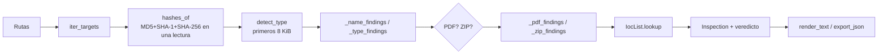

# 13 · Verificador de archivos sospechosos

> Herramienta de laboratorio y aprendizaje. Lee archivos locales sin ejecutarlos, abrirlos ni extraerlos.

Calcula MD5, SHA-1 y SHA-256, identifica el tipo real por los primeros bytes y señala indicios: doble extensión (`factura.pdf.exe`), ejecutables disfrazados de imagen, caracteres que invierten el nombre (`U+202E`), PDF con JavaScript, documentos de Office con scripts dentro, ZIP con rutas peligrosas y coincidencias con una lista local de indicadores (IOC). Cada indicio trae gravedad, explicación y qué hacer.

[← Volver al portafolio de ciberseguridad](../README.md) · Proyectos relacionados: [07 · Duplicados](../07-buscador-duplicados/README.md), [06 · Analizador de correos](../06-analizador-correos/README.md), [03 · Validador de archivos](../03-validador-archivos/README.md)

## Contenido

1. [Qué problema resuelve](#1-qué-problema-resuelve)
2. [Instalación desde cero](#2-instalación-desde-cero)
3. [Comandos](#3-comandos)
4. [Ejemplo de entrada y salida](#4-ejemplo-de-entrada-y-salida)
5. [Archivos y carpetas](#5-archivos-y-carpetas)
6. [Funciones principales y recorrido de los datos](#6-funciones-principales-y-recorrido-de-los-datos)
7. [Dependencias](#7-dependencias)
8. [Limitaciones y errores frecuentes](#8-limitaciones-y-errores-frecuentes)
9. [Pruebas](#9-pruebas)
10. [Ejercicios](#10-ejercicios)
11. [Preguntas de entrevista](#11-preguntas-de-entrevista)
12. [Guion de demostración](#12-guion-de-demostración)
13. [Capturas](#13-capturas)

## 1. Qué problema resuelve

Un usuario reporta "me llegó un adjunto raro" o aparece un archivo desconocido en una carpeta compartida. Antes de abrirlo hay que responder: ¿qué es realmente?, ¿su nombre intenta engañar?, ¿su huella ya está en una lista de indicadores? Esta es la primera revisión (triaje) que hace un analista de soporte o de SOC.

Útil para:

- Practicar huellas (hash), firmas de archivo ("números mágicos") y trucos de nombres usados en phishing.
- Revisar adjuntos guardados del [proyecto 06](../06-analizador-correos/README.md) sin abrirlos.
- Preparar el hash para consultarlo en una fuente de inteligencia (por ejemplo, el buscador de VirusTotal), sin subir el archivo.

No es un antivirus: no analiza comportamiento ni conoce malware real. **SIN INDICIOS no significa seguro.**

## 2. Instalación desde cero

Requisitos: Python 3.10 o superior.

**Linux Mint**

```bash
cd Tipos-de-Proyectos/ciberseguridad/13-verificador-archivos
python3 -m venv .venv
source .venv/bin/activate
python -m pip install -r requirements-dev.txt
```

**Windows (PowerShell)**

```powershell
cd Tipos-de-Proyectos\ciberseguridad\13-verificador-archivos
py -m venv .venv
.\.venv\Scripts\Activate.ps1
python -m pip install -r requirements-dev.txt
```

Solo biblioteca estándar; `requirements-dev.txt` instala `pytest`.

## 3. Comandos

Ejecuta todo desde la carpeta `ciberseguridad/13-verificador-archivos`.

| Objetivo | Comando |
|---|---|
| Demostración completa (archivos temporales que se borran) | `python -m file_inspector --demo` |
| Revisar la carpeta de ejemplo con la lista de indicadores | `python -m file_inspector samples/archivos --iocs samples/iocs_lab.txt` |
| Un archivo, con las tres huellas | `python -m file_inspector samples/archivos/notas.txt --all-hashes` |
| Una carpeta con subcarpetas | `python -m file_inspector ~/Descargas -r` |
| Usarlo en un script (código 3 si hay algo sospechoso) | `python -m file_inspector adjuntos/ --fail-on sospechoso` |
| Exportar | `python -m file_inspector --demo --export-json output/triaje.json` |
| Ayuda | `python -m file_inspector --help` |
| Pruebas | `python -m pytest` |

| Opción | Uso |
|---|---|
| `-r`, `--recursive` | revisa subcarpetas (sin seguir enlaces simbólicos) |
| `--iocs ARCHIVO` | lista de huellas conocidas; con `--demo` se usa `samples/iocs_lab.txt` |
| `--all-hashes` | muestra SHA-1 y MD5 además de SHA-256 |
| `--fail-on sospechoso\|revisar` | devuelve `3` si algún archivo alcanza ese nivel |
| `--export-json RUTA`, `--force` | exporta; no sobrescribe sin `--force` |

Códigos de salida: `0` correcto, `1` error de entrada o exportación, `2` argumentos inválidos, `3` nivel de `--fail-on` alcanzado.

### Indicios que revisa

| Código | Gravedad | Qué significa |
|---|---|---|
| `COINCIDE_CON_IOC` | ALTA | su MD5, SHA-1 o SHA-256 está en la lista de indicadores |
| `DOBLE_EXTENSION` | ALTA | `algo.pdf.exe`: extensión señuelo seguida de una ejecutable |
| `EJECUTABLE_DISFRAZADO` | ALTA | contenido PE, ELF, Mach-O o LNK con extensión que no es ejecutable |
| `NOMBRE_BIDI` | ALTA | carácter que invierte el orden visual del nombre |
| `ZIP_SLIP` | ALTA | rutas con `..` o absolutas dentro del ZIP |
| `EXTENSION_RIESGOSA` | MEDIA | `.exe`, `.js`, `.vbs`, `.hta`, `.docm`, `.iso`, `.lnk`... |
| `CONTENIDO_EJECUTABLE` | MEDIA | es un ejecutable con su extensión correcta |
| `TIPO_NO_COINCIDE` | MEDIA | p. ej. texto guardado como `.jpg` |
| `PDF_ACTIVO` | MEDIA | `/JavaScript`, `/JS`, `/OpenAction`, `/Launch`, `/EmbeddedFile` o `/AA` |
| `ZIP_CON_EJECUTABLES`, `ZIP_CIFRADO`, `ZIP_ENORME` | MEDIA | contenido que un documento normal no trae, o que el antivirus no puede revisar |
| `NOMBRE_ESPACIOS` | MEDIA | muchos espacios para empujar la extensión fuera de la vista |
| `VACIO`, `NOMBRE_LARGO`, `ZIP_DANADO` | BAJA | informativos |

Veredicto = gravedad más alta: ALTA → **SOSPECHOSO**, MEDIA → **REVISAR**, nada o BAJA → **SIN INDICIOS**.

## 4. Ejemplo de entrada y salida

```bash
python -m file_inspector --demo
```

Crea en una carpeta temporal 8 archivos sintéticos e inofensivos (los "ejecutables" solo empiezan con los bytes `MZ` seguidos de texto; no son programas) y los analiza. Salida real (fragmento):

```text
Modo demostración: archivos sintéticos creados en una carpeta temporal (se borran al terminar).

Verificador de archivos sospechosos - Cybersecurity Python Lab
==============================================================

Archivos revisados: 8 | SOSPECHOSO: 5 | REVISAR: 2 | SIN INDICIOS: 1
Lista de indicadores: samples/iocs_lab.txt (3 huellas)
  Aviso: línea 7 de la lista no es una huella válida: esto-no-es-una-huella  # línea inválida a propósito: se reporta como aviso

[SOSPECHOSO] factura_noviembre.pdf.exe
  Tamaño: 100 B | tipo real: ejecutable de Windows (PE) | extensión: .exe
  SHA-256: c35e9840fc20a4ee5d510454e7c36e9a378a5657bcb75712894136db4e3f24ff
  - ALTA  DOBLE_EXTENSION: doble extensión: aparenta ser '.pdf' pero termina en '.exe'
          Qué hacer: no lo abras: Windows oculta por defecto la última extensión y quien lo reciba verá un documento; activa la opción de mostrar extensiones y reporta de dónde llegó
  - MEDIA CONTENIDO_EJECUTABLE: el contenido es ejecutable de Windows (PE)

[SOSPECHOSO] foto_vacaciones.jpg
  Tamaño: 100 B | tipo real: ejecutable de Windows (PE) | extensión: .jpg
  SHA-256: c35e9840fc20a4ee5d510454e7c36e9a378a5657bcb75712894136db4e3f24ff
  - ALTA  EJECUTABLE_DISFRAZADO: el contenido es ejecutable de Windows (PE) pero la extensión es '.jpg'
          Qué hacer: no lo abras ni lo renombres; calcula su hash y consúltalo en tu fuente de inteligencia

[SOSPECHOSO] pago‮fdp.exe
  ...
  - ALTA  NOMBRE_BIDI: el nombre contiene un carácter de control bidireccional (p. ej. U+202E) que invierte cómo se ve: la extensión real queda oculta

[REVISAR] contrato.docx
  - MEDIA ZIP_CON_EJECUTABLES: contiene archivos que se ejecutan: word/payload.js

[REVISAR] estado_de_cuenta.pdf
  - MEDIA PDF_ACTIVO: el PDF declara contenido activo: /JS, /JavaScript, /OpenAction

[SIN INDICIOS] notas_reunion.txt
```

Observa:

- `factura_noviembre.pdf.exe`, `foto_vacaciones.jpg` y `pago…exe` tienen **la misma huella**: es el mismo contenido con tres disfraces. Por eso se investiga por hash, no por nombre.
- `pago‮fdp.exe` se vería en el explorador como `pagoexe.pdf`. El reporte muestra el carácter escapado para no caer en el truco.

Con los ejemplos guardados en el repositorio:

```bash
python -m file_inspector samples/archivos --iocs samples/iocs_lab.txt
```

```text
Archivos revisados: 6 | SOSPECHOSO: 1 | REVISAR: 1 | SIN INDICIOS: 4
...
[SOSPECHOSO] samples/archivos/muestra_ioc.txt
  - ALTA  COINCIDE_CON_IOC: su huella está en la lista de indicadores: muestra de laboratorio LAB-IOC-001
[REVISAR] samples/archivos/imagen_perfil.jpg
  - MEDIA TIPO_NO_COINCIDE: la extensión '.jpg' no corresponde al contenido real (texto)
```

## 5. Archivos y carpetas

```
13-verificador-archivos/
├── README.md
├── requirements.txt / requirements-dev.txt / pytest.ini
├── file_inspector/
│   ├── __main__.py      permite "python -m file_inspector"
│   ├── cli.py           argumentos, modo --demo, --fail-on y códigos de salida
│   ├── signatures.py    firmas de archivo, extensiones riesgosas y señuelo, caracteres bidi
│   ├── iocs.py          lee la lista de huellas y reporta líneas inválidas
│   ├── inspector.py     reglas: nombre, tipo, PDF, ZIP, IOC; veredicto
│   ├── demo.py          crea los archivos sintéticos de la demostración
│   └── report.py        texto y JSON; escapa caracteres de control y bidi
├── samples/
│   ├── README.md        qué contiene cada ejemplo
│   ├── iocs_lab.txt     lista de indicadores sintética (con una línea inválida a propósito)
│   └── archivos/        6 archivos inofensivos
├── tests/
└── docs/screenshots/
```

## 6. Funciones principales y recorrido de los datos



1. **`hashes_of`** lee el archivo una sola vez por bloques de 1 MiB y alimenta las tres huellas; guarda los primeros 8 KiB para identificar el tipo.
2. **`detect_type`** compara esos bytes con la tabla `SIGNATURES`; si no coincide y no hay bytes nulos, prueba si es texto UTF-8.
3. **`_name_findings`** revisa extensiones (todas, no solo la última), caracteres bidi y espacios de relleno.
4. **`_type_findings`** compara el tipo real con la extensión: un ejecutable con extensión de imagen es ALTA; un texto con extensión de imagen es MEDIA.
5. **`_pdf_findings`** busca palabras clave de contenido activo en los primeros 5 MiB sin interpretar el PDF; **`_zip_findings`** lee solo el índice del ZIP (`infolist`), nunca extrae.
6. **`IocList.lookup`** busca las tres huellas en la lista local.

## 7. Dependencias

| Paquete | Para qué | Cuándo |
|---|---|---|
| Biblioteca estándar (`hashlib`, `zipfile`, `re`, `os`, `pathlib`, `json`, `tempfile`) | todo | siempre |
| `pytest` | pruebas | solo desarrollo |

## 8. Limitaciones y errores frecuentes

**Limitaciones**

- Reglas estáticas: no detecta malware sin indicios en el nombre o el formato, ni analiza comportamiento. No sustituye a un antivirus ni a un sandbox.
- La búsqueda de palabras clave en PDF puede fallar si el PDF comprime u ofusca sus objetos, y puede marcar PDFs legítimos con formularios (`/AA`).
- Solo inspecciona el índice de los ZIP (no ZIP dentro de ZIP, ni RAR o 7z por dentro).
- La lista de indicadores es local y de laboratorio; en un trabajo real vendría de tu fuente de inteligencia.
- MD5 y SHA-1 se muestran solo para buscar en listas antiguas; no se usan para afirmar que dos archivos son iguales.

**Errores frecuentes**

| Mensaje | Causa | Solución |
|---|---|---|
| `No existe la lista de indicadores` | ruta de `--iocs` mal escrita | revisa la ruta |
| `No revisados: ... no se pudo abrir` | el archivo no existe o no tienes permiso | revisa la ruta; no uses permisos de administrador |
| `... ya existe. Usa --force` | protección contra sobrescritura | cambia el nombre o agrega `--force` |
| El antivirus de Windows avisa al crear la demo | algunos antivirus vigilan archivos que empiezan con `MZ` | los archivos son texto inofensivo y se borran al terminar; si lo bloquea, usa los ejemplos de `samples/archivos` |

## 9. Pruebas

```bash
python -m pytest
python -m pytest -v
```

| Archivo | Qué comprueba |
|---|---|
| `test_inspector.py` | detección de 10 tipos, texto cortado a mitad de carácter, extensiones múltiples, huellas iguales a `hashlib`, cada regla (doble extensión, disfraz, bidi, espacios, PDF activo, ZIP con scripts, ZIP slip, ZIP dañado, vacío), lista de IOC y los veredictos exactos de los ejemplos y de la demo |
| `test_cli.py` | salida con y sin IOC, demo con nombre escapado, `--all-hashes`, `--fail-on`, exportación y `--force`, errores, ejecución con `python -m` |

**Pruebas ejecutadas** al preparar esta entrega (Linux x86_64 en la nube, 24 de noviembre de 2026): `python -m pytest` → **47 passed** con Python 3.11 y 3.13.

**Pruebas pendientes de ejecutar por ti**: Linux Mint y Windows en tus equipos.

## 10. Ejercicios

1. **Entropía.** Calcula la entropía de Shannon de cada archivo (0 a 8 bits por byte) y agrega un indicio BAJA para ejecutables con entropía mayor a 7.2 (posible empaquetado o cifrado). Prueba con un ZIP y con un texto.
2. **ZIP dentro de ZIP.** Si un ZIP contiene otro ZIP, revisa también su índice (con un límite de profundidad de 2 para evitar "bombas zip").
3. **Reglas en JSON.** Mueve `RISKY_EXTENSIONS` y `DECOY_EXTENSIONS` a `config/settings.json` para que un analista las ajuste sin tocar el código, y valida que cada extensión empiece con punto.

## 11. Preguntas de entrevista

**1. ¿Por qué no confías en la extensión?**
Porque la elige quien nombra el archivo. El tipo real está en los primeros bytes: un ejecutable de Windows siempre empieza con `MZ`. Si el contenido es ejecutable y la extensión es `.jpg`, alguien intentó engañar a una persona o a un filtro.

**2. ¿Qué es la doble extensión y por qué funciona?**
Windows oculta por defecto la última extensión, así que `factura.pdf.exe` se ve como `factura.pdf`. Solo la marco como ALTA si la penúltima es una extensión "señuelo" (documento, imagen) y la última es ejecutable; `backup.tar.gz` no es sospechoso.

**3. ¿Para qué sirve el carácter U+202E?**
Es un control de dirección derecha a izquierda. `pago‮fdp.exe` se muestra como `pagoexe.pdf`. Por eso el reporte escapa esos caracteres en vez de imprimirlos: si los imprimiera, la propia terminal mostraría el nombre falso.

**4. ¿Por qué calculas MD5 si dices que está roto?**
Porque muchas listas de indicadores y reportes antiguos todavía publican MD5 o SHA-1, y necesito buscar ahí. Pero para decidir si dos archivos son iguales uso SHA-256. Las tres se calculan en una sola lectura.

**5. ¿Cómo evitas que tu herramienta sea el vector de ataque?**
Nunca ejecuto ni extraigo: del ZIP solo leo el índice, del PDF solo busco palabras. Leo por bloques con límites (8 KiB para el tipo, 5 MiB para el PDF, 1000 entradas de ZIP). Escapo los nombres al mostrarlos. Y los ejemplos peligrosos de la demo no viven en el repositorio: se crean en una carpeta temporal y se borran.

## 12. Guion de demostración

Duración aproximada: 2 minutos.

1. (15 s) "Este es el verificador de archivos de mi laboratorio: el primer triaje de un adjunto sospechoso, sin abrirlo."
2. (30 s) Ejecuta `python -m file_inspector --demo`. Señala el resumen: 5 sospechosos, 2 por revisar, 1 sin indicios.
3. (25 s) Muestra que `factura_noviembre.pdf.exe`, `foto_vacaciones.jpg` y `pago…exe` tienen el mismo SHA-256: "mismo contenido, tres disfraces".
4. (20 s) Explica el `‮`: "en el explorador se vería como pagoexe.pdf".
5. (15 s) Señala `contrato.docx` con un `.js` dentro y el PDF con `/OpenAction`.
6. (15 s) Ejecuta con `samples/archivos --iocs samples/iocs_lab.txt` y muestra la coincidencia con el indicador. Cierra: "SIN INDICIOS no significa seguro; esto prioriza qué investigar".

## 13. Capturas

Pendiente: agrega capturas reales después de ejecutar la herramienta en tu equipo y guárdalas en [`docs/screenshots/`](docs/screenshots/README.md).
