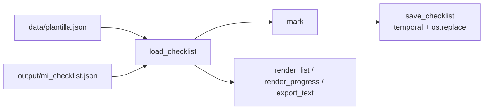

# 14 · Checklist de seguridad

> Herramienta de laboratorio y aprendizaje. Guarda tu avance solo en tu equipo (`output/`, que Git ignora).

Lista de 18 prácticas de seguridad para una persona o un negocio pequeño (cuentas, equipo, respaldos, red de casa, navegador y correo, teléfono), cada una con **por qué importa**. Marcas cada tarea como `pendiente`, `en_progreso`, `hecho` o `no_aplica`, agregas notas, ves el avance por categoría y exportas a Markdown o CSV. La plantilla y tu avance son archivos separados, y el avance se guarda de forma atómica.

[← Volver al portafolio de ciberseguridad](../README.md) · Proyectos relacionados: [02 · Laboratorio 2FA](../02-laboratorio-2fa/README.md), [04 · Monitor del sistema](../04-monitor-sistema/README.md)

## Contenido

1. [Qué problema resuelve](#1-qué-problema-resuelve)
2. [Instalación desde cero](#2-instalación-desde-cero)
3. [Comandos](#3-comandos)
4. [Ejemplo de entrada y salida](#4-ejemplo-de-entrada-y-salida)
5. [Archivos y carpetas](#5-archivos-y-carpetas)
6. [Funciones principales y recorrido de los datos](#6-funciones-principales-y-recorrido-de-los-datos)
7. [Dependencias](#7-dependencias)
8. [Limitaciones y errores frecuentes](#8-limitaciones-y-errores-frecuentes)
9. [Pruebas](#9-pruebas)
10. [Ejercicios](#10-ejercicios)
11. [Preguntas de entrevista](#11-preguntas-de-entrevista)
12. [Guion de demostración](#12-guion-de-demostración)
13. [Capturas](#13-capturas)

## 1. Qué problema resuelve

La seguridad básica es una lista de hábitos que casi nadie termina: MFA, respaldos probados, disco cifrado, router sin contraseña de fábrica. Esta checklist los ordena, explica por qué cada uno importa y muestra el avance, como se hace en una auditoría ligera o en el alta de un equipo nuevo en una empresa. Como proyecto de programación practica **persistencia local segura**: no perder datos si algo falla y no destruir un archivo dañado.

## 2. Instalación desde cero

Requisitos: Python 3.10 o superior.

**Linux Mint**

```bash
cd Tipos-de-Proyectos/ciberseguridad/14-checklist-seguridad
python3 -m venv .venv
source .venv/bin/activate
python -m pip install -r requirements-dev.txt
```

**Windows (PowerShell)**

```powershell
cd Tipos-de-Proyectos\ciberseguridad\14-checklist-seguridad
py -m venv .venv
.\.venv\Scripts\Activate.ps1
python -m pip install -r requirements-dev.txt
```

## 3. Comandos

Ejecuta todo desde la carpeta `ciberseguridad/14-checklist-seguridad`.

| Objetivo | Comando |
|---|---|
| Demostración (archivo temporal) | `python -m security_checklist demo` |
| Ver todas las tareas | `python -m security_checklist list` |
| Ver por qué importa cada una | `python -m security_checklist list --why` |
| Solo pendientes de una categoría | `python -m security_checklist list --category Equipo --status pendiente` |
| Marcar una tarea | `python -m security_checklist mark cuentas-01 hecho --note "MFA con app"` |
| Avance por categoría | `python -m security_checklist progress` |
| Exportar a Markdown | `python -m security_checklist export --format md --output output/checklist.md` |
| Exportar a CSV | `python -m security_checklist export --format csv --output output/checklist.csv` |
| Empezar de nuevo | `python -m security_checklist reset --yes` |
| Pruebas | `python -m pytest` |

Estados: `pendiente` `[ ]`, `en_progreso` `[~]`, `hecho` `[x]`, `no_aplica` `[-]`. El porcentaje no cuenta las tareas que no aplican. `--file` usa otro archivo de avance (por ejemplo, uno para el negocio y otro personal) y `--template` otra plantilla.

Códigos de salida: `0` correcto, `1` error (plantilla, avance, id o estado inválidos, exportación), `2` argumentos inválidos.

## 4. Ejemplo de entrada y salida

```bash
python -m security_checklist demo
```

Salida real (fragmento):

```text
Modo demostración: se usa un archivo temporal; tu avance real no se toca.

$ python -m security_checklist mark cuentas-01 hecho --note "MFA con app de autenticación"
...
$ python -m security_checklist progress
Avance: [#####.........................] 18 %  (hecho 3, en progreso 1, pendiente 13, no aplica 1)

  Cuentas             1/4
  Equipo              1/5
  Respaldos           1/2
  Red de casa         0/2
  Navegador y correo  0/2
  Teléfono            0/2

Siguiente sugerida: cuentas-02 - Usar un gestor de contraseñas con una contraseña única por sitio

$ python -m security_checklist list --category Equipo
Equipo
  [x] equipo-01     Activar actualizaciones automáticas del sistema operativo
  [~] equipo-02     Cifrar el disco (BitLocker en Windows, LUKS en Linux Mint)
      Nota: falta guardar la llave de recuperación
  [ ] equipo-03     Usar una cuenta sin privilegios de administrador para el día a día
  ...
```

## 5. Archivos y carpetas

```
14-checklist-seguridad/
├── README.md
├── requirements.txt / requirements-dev.txt / pytest.ini
├── data/plantilla.json       18 tareas editables (qué hacer y por qué)
├── security_checklist/
│   ├── __main__.py
│   ├── store.py              plantilla, avance, guardado atómico, mark
│   └── cli.py                list, mark, progress, export, reset, demo
├── output/                   tu avance (lo crea la herramienta; Git lo ignora)
├── tests/
└── docs/screenshots/
```

## 6. Funciones principales y recorrido de los datos



1. **`load_template`** valida cada tarea (id único y campos completos) y junta todos los errores.
2. **`load_checklist`** combina la plantilla con tu avance. Si el archivo de avance está dañado, **no lo sobrescribe**: muestra el error y te pide revisarlo. Las tareas del avance que ya no están en la plantilla se conservan y se avisa.
3. **`mark`** valida id, estado y longitud de la nota, y registra la hora en UTC.
4. **`save_checklist`** escribe un temporal y lo reemplaza con `os.replace` (operación atómica): si se va la luz a mitad del guardado, queda el archivo anterior completo. Solo guarda las tareas que cambiaron.
5. **`export_text`** genera Markdown (neutraliza `<` y `>` de las notas) o CSV (neutraliza fórmulas).

## 7. Dependencias

| Paquete | Para qué | Cuándo |
|---|---|---|
| Biblioteca estándar (`json`, `os`, `csv`, `tempfile`, `argparse`) | todo | siempre |
| `pytest` | pruebas | solo desarrollo |

## 8. Limitaciones y errores frecuentes

**Limitaciones**

- Es una herramienta para una persona: si dos procesos marcan tareas al mismo tiempo, gana el último en guardar.
- Las recomendaciones son generales; un negocio con datos de clientes necesita además políticas y, según el caso, cumplir la ley de protección de datos.
- No verifica nada automáticamente (por ejemplo, no revisa si BitLocker está activo): confía en lo que marques. El ejercicio 3 propone una verificación.

**Errores frecuentes**

| Mensaje | Causa | Solución |
|---|---|---|
| `No se pudo leer tu avance ... No se sobrescribió` | editaste el JSON a mano y quedó inválido | corrígelo o muévelo a otro lugar para empezar de nuevo |
| `no existe la tarea 'x'` | id mal escrito | `python -m security_checklist list` muestra los id |
| `Aviso: tu avance tiene la tarea ...` | quitaste esa tarea de la plantilla | se conserva; bórrala del avance si ya no la quieres |

## 9. Pruebas

```bash
python -m pytest
python -m pytest -v
```

| Archivo | Qué comprueba |
|---|---|
| `test_checklist.py` | plantilla válida, primera ejecución sin crear archivos, marcar-guardar-recargar, porcentaje sin "no aplica", solo se guardan cambios y no quedan temporales, errores de id/estado/nota, avance dañado que no se sobrescribe, estado inválido, tareas huérfanas, errores de plantilla, flujo de la interfaz, `reset` con confirmación, exportación Markdown/CSV con texto malicioso, escape de caracteres de control, `demo` no toca tu avance, ejecución con `python -m` |

**Pruebas ejecutadas** al preparar esta entrega (Linux x86_64 en la nube, 24 de noviembre de 2026): `python -m pytest` → **17 passed** con Python 3.11 y 3.13.

**Pruebas pendientes de ejecutar por ti**: Linux Mint y Windows en tus equipos.

## 10. Ejercicios

1. **Plantilla para tu negocio.** Copia `data/plantilla.json` a `data/plantilla_negocio.json` con tareas para tu tienda en línea (acceso al panel con MFA, respaldos de la base de datos, revisar quién tiene acceso a las cuentas de pago) y úsala con `--template` y `--file output/negocio.json`.
2. **Fechas límite.** Agrega un campo opcional `"vence": "2026-12-31"` y muestra en `progress` las tareas vencidas.
3. **Verificación automática.** Para `equipo-05`, agrega un comando `check` que en Windows consulte el estado del firewall con `netsh advfirewall show allprofiles state` (solo lectura) y en Linux Mint con `ufw status`, y sugiera marcar la tarea.

## 11. Preguntas de entrevista

**1. ¿Por qué separas la plantilla del avance?**
Porque cambian por razones distintas: la plantilla la mejoro yo y se versiona en Git; el avance es personal (puede tener notas sensibles) y no debe subirse. Separados, actualizar la plantilla no borra el avance.

**2. ¿Qué es una escritura atómica?**
Escribir primero un archivo temporal y luego reemplazar el original en una sola operación (`os.replace`). Si el programa se interrumpe a la mitad, el original sigue completo. Escribir directo sobre el archivo podría dejarlo a medias e inservible.

**3. ¿Por qué no sobrescribes un archivo de avance dañado?**
Porque contiene trabajo del usuario. Si lo reemplazo por uno vacío, pierde todo sin saberlo. Prefiero detenerme, explicar el problema y dejar que la persona decida.

**4. ¿Por qué neutralizas texto en la exportación?**
Las notas son texto libre. En Markdown, una nota con `<script>` podría interpretarse como HTML en algunos visores; en CSV, una nota que empieza con `=` se ejecutaría como fórmula en Excel. Escapo ambas cosas.

## 12. Guion de demostración

Duración aproximada: 1 minuto y medio.

1. (15 s) "Esta es la checklist de seguridad de mi laboratorio: 18 hábitos con el porqué de cada uno."
2. (30 s) Ejecuta `python -m security_checklist demo` y explica el avance y la siguiente tarea sugerida.
3. (20 s) Ejecuta `list --why --category Respaldos` y lee el porqué del 3-2-1.
4. (25 s) Corrompe a propósito un archivo de avance de prueba y muestra que la herramienta se detiene sin sobrescribirlo. Cierra: "nunca destruir datos del usuario".

## 13. Capturas

Pendiente: agrega capturas reales después de ejecutar la herramienta en tu equipo y guárdalas en [`docs/screenshots/`](docs/screenshots/README.md).
